<picture><source media="(prefers-color-scheme: dark)" srcset="assets/dist/hero-healthcare-jobs-dark.svg"><source media="(prefers-color-scheme: light)" srcset="assets/dist/hero-healthcare-jobs-light.svg"></picture>

<a href="#open-jobs"><picture><source media="(prefers-color-scheme: dark)" srcset="assets/dist/btn-primary-dark.svg"><source media="(prefers-color-scheme: light)" srcset="assets/dist/btn-primary-light.svg"></picture></a>

<a href="https://chromewebstore.google.com/detail/gmdkffapbfeanfecgcodocfcefldjaho"><picture><source media="(prefers-color-scheme: dark)" srcset="assets/dist/btn-extension-dark.svg"><source media="(prefers-color-scheme: light)" srcset="assets/dist/btn-extension-light.svg"></picture></a>&nbsp;&nbsp;<a href="https://jobhacki.com/login-v2"><picture><source media="(prefers-color-scheme: dark)" srcset="assets/dist/btn-account-dark.svg"><source media="(prefers-color-scheme: light)" srcset="assets/dist/btn-account-light.svg"></picture></a>

Join the JobHacki Discord community to talk about jobs with other job seekers.

<a href="https://discord.gg/RApjXmgnwA">Talk about healthcare jobs and what you are seeing in #leads-health.</a>

**⭐ Star this repo to find the healthcare jobs list again easily.**

<table><tr><td align="center" valign="top"><h3>55,167</h3>open healthcare jobs in this list (latest refresh)</td><td align="center" valign="top"><h3>150</h3>freshest rows shown below</td><td align="center" valign="top"><h3>2026-11-17</h3>newest posting date</td></tr></table>

Snapshot 2026-11-17 16:17 UTC

**Hi, I'm Sophia, JobHacki's AI assistant. Pick a list, inspect a role, and follow its employer link.**

Explore clinical, caregiving, and medical office roles in this fresh slice of jobs taken from employers' own hiring systems. Updated Nov 17, 2026.

[Back to all 12 lists](https://github.com/Jobhacki/jobs)

 

<picture><source media="(prefers-color-scheme: dark)" srcset="assets/dist/divider-dark.svg"><source media="(prefers-color-scheme: light)" srcset="assets/dist/divider-light.svg"></picture>

## How to use this list

1. Scan the table for clinical, care, or medical office roles that fit your background.
2. Check the posting date and confirm any credentials on the employer's page.
3. Open the employer's apply link to review the role and apply.
4. If useful, try the Chrome extension, free account, or Discord as optional extras.
5. Report a dead link or suggest a healthcare job using [CONTRIBUTING.md](CONTRIBUTING.md) and issues.

## Open jobs

**55,167 open healthcare jobs seen in the latest refresh.** The table shows the freshest 150. **Last updated: 2026-11-17 16:17 UTC.** Apply links go to the employer's career page or hiring system.

<!-- JOBS_TABLE_START -->
| Role | Employer | Location | Pay | Posted | Apply |
|---|---|---|---|---|---|
| Medical Director - BlueCare TN | bcbst | USA, TN, Chattanooga, Remote |  | 2026-11-17 | [Apply](https://bcbst.wd1.myworkdayjobs.com/en-US/external/job/USA-TN-Chattanooga-Remote/Medical-Director---BlueCare-TN_R-51721) |
| Registered Respiratory Therapist | uvmhealth | Malone, NY |  | 2026-11-17 | [Apply](https://uvmhealth.wd1.myworkdayjobs.com/en-US/ahmc/job/Malone-NY/Registered-Respiratory-Therapist_R0091856) |
| Patient Sitter - Patient Logistics Support | uvmhealth | Plattsburgh, NY |  | 2026-11-17 | [Apply](https://uvmhealth.wd1.myworkdayjobs.com/en-US/cvph/job/Plattsburgh-NY/Patient-Sitter---Patient-Logistics-Support_R0091961) |
| Mental Health Technician - Inpatient Psychiatry | uvmhealth | Plattsburgh, NY |  | 2026-11-17 | [Apply](https://uvmhealth.wd1.myworkdayjobs.com/en-US/cvph/job/Plattsburgh-NY/CVPH-Mental-Health-Technician---Inpatient-Psychiatry_R0064021) |
| Clinical Review Nurse - Concurrent Review | centene | Remote-FL |  | 2026-11-17 | [Apply](https://centene.wd5.myworkdayjobs.com/en-US/centene_external/job/Remote-FL/Clinical-Review-Nurse---Concurrent-Review_1676649) |
| Medical Receptionist//Patient Care Coordinator | gn | AZ, Prescott |  | 2026-11-17 | [Apply](https://gn.wd3.myworkdayjobs.com/en-US/beltonecareers/job/AZ-Prescott/Medical-Receptionist--Patient-Care-Coordinator_R30830-1) |
| Dental Assistant - Surgical | aspendental | Arlington, Texas |  | 2026-11-17 | [Apply](https://aspendental.wd1.myworkdayjobs.com/en-US/careers_clearchoice/job/Arlington-Texas/Dental-Assistant---Surgical_R2026-014203-1) |
| Dental Assistant - Prosthodontist | aspendental | Federal Way, Washington |  | 2026-11-17 | [Apply](https://aspendental.wd1.myworkdayjobs.com/en-US/careers_clearchoice/job/Federal-Way-Washington/Dental-Assistant---Prosthodontist_R2026-014223) |
| Physical Therapist (PT) - Nassau 1099 | alwayscompassionate | Hempstead, NY |  | 2026-11-17 | [Apply](https://alwayscompassionate.wd1.myworkdayjobs.com/en-US/achomecare/job/Hempstead-NY/Physical-Therapist--PT----Nassau-1099_JR103216) |
| Associate Medical Director, US Rare Neurology | astrazeneca | US - Boston - MA |  | 2026-11-17 | [Apply](https://astrazeneca.wd3.myworkdayjobs.com/en-US/alexion/job/US---Boston---MA/Associate-Medical-Director--US-Rare-Neurology_R-264517) |
| Meadows of Napa Valley - Certified Nursing Assistants - Care Center (FT/PT/NOC... | transformingage | Napa, CA |  | 2026-11-17 | [Apply](https://transformingage.wd108.myworkdayjobs.com/en-US/joinus/job/Napa-CA/Meadows-of-Napa-Valley----Certified-Nursing-Assistants---Care-Center--FT-PT-NOC-Available-_JR102690) |
| Medical Assistant (Full Time) | schweigerderm | NJ - Morristown |  | 2026-11-17 | [Apply](https://schweigerderm.wd12.myworkdayjobs.com/en-US/schweigercareers/job/NJ---Morristown/Medical-Assistant--Full-Time-_R-2557) |
| Medical Assistant | aoncology | US-NV-Las Vegas |  | 2026-11-17 | [Apply](https://aoncology.wd12.myworkdayjobs.com/en-US/aoncology_careers/job/US-NV-Las-Vegas/Medical-Assistant_JR7799) |
| Medical Scribe | aoncology | US-TX-Houston |  | 2026-11-17 | [Apply](https://aoncology.wd12.myworkdayjobs.com/en-US/aoncology_careers/job/US-TX-Houston/Medical-Scribe_JR7700) |
| Dental Hygienist | guardiandentistry | Greensboro, NC |  | 2026-11-17 | [Apply](https://guardiandentistry.wd501.myworkdayjobs.com/en-US/external_careers/job/Greensboro-NC/Dental-Hygienist_JR103839) |
| Patient Care Technician (PCT) | aspendental | Oswego, New York |  | 2026-11-17 | [Apply](https://aspendental.wd1.myworkdayjobs.com/en-US/wellnowurgentcarecareers/job/Oswego-New-York/Patient-Care-Technician--PCT-_R2026-011184) |
| Technician Aide, Radiology - Per Diem | valleyhealthlink | Winchester, VA |  | 2026-11-17 | [Apply](https://valleyhealthlink.wd115.myworkdayjobs.com/en-US/valleyhealthcareers/job/Winchester-VA/Technician-Aide--Radiology---Per-Diem_JR109990) |
| Registered Nurse - Inpatient Behavioral Health - Day Shift | gmh | Main Grady Campus (Downtown Atlanta) |  | 2026-11-17 | [Apply](https://gmh.wd12.myworkdayjobs.com/en-US/external_careers/job/Main-Grady-Campus-Downtown-Atlanta/Registered-Nurse---Inpatient-Behavioral-Health---Day-Shift_R26006189) |
| Nursing Support Technician - Surgical Ortho - Full-time night | gmh | Main Grady Campus (Downtown Atlanta) |  | 2026-11-17 | [Apply](https://gmh.wd12.myworkdayjobs.com/en-US/external_careers/job/Main-Grady-Campus-Downtown-Atlanta/Nursing-Support-Technician---Surgical-Ortho---Full-time-night_R26006015) |
| Assistant Nurse Manager - 5N Medical Unit | christianacare | Wilmington, DE |  | 2026-11-17 | [Apply](https://christianacare.wd5.myworkdayjobs.com/en-US/cchs/job/Wilmington-DE/Assistant-Nurse-Manager---5N-Medical-Unit_JR94926) |
| Medication Tech (Med Tech) / Full-Time / 3 p.m. - 11 p.m. | harmonyseniorservices | Roanoke, Virginia |  | 2026-11-17 | [Apply](https://harmonyseniorservices.wd108.myworkdayjobs.com/en-US/harmony_careers/job/Roanoke-Virginia/Medication-Tech--Med-Tech----Full-Time---3-pm---11-pm_JR-005342) |
| Clinical Provider - Outpatient | brightli | Republic, MO |  | 2026-11-17 | [Apply](https://brightli.wd5.myworkdayjobs.com/en-US/brightlitalent/job/Republic-MO/Clinical-Provider---Outpatient_R-27100) |
| Behavioral Health Technician (M-F 2PM-7PM) | brightli | Independence, MO |  | 2026-11-17 | [Apply](https://brightli.wd5.myworkdayjobs.com/en-US/brightlitalent/job/Independence-MO/Behavioral-Health-Technician--M-F-2PM-7PM-_R-24711) |
| Medical Assistant Sign on Bonus | gohealthuc | Branford - Branford, CT |  | 2026-11-17 | [Apply](https://gohealthuc.wd12.myworkdayjobs.com/en-US/external/job/Branford---Branford-CT/Medical-Assistant-Sign-on-Bonus_JR113246) |
| Medical Assistant-Sign on Bonus $3500 | gohealthuc | Granby - Granby, CT |  | 2026-11-17 | [Apply](https://gohealthuc.wd12.myworkdayjobs.com/en-US/external/job/Granby---Granby-CT/Medical-Assistant-Sign-on-Bonus--3500_JR113249) |
| Clinical Team Aide | allina | Allina Health West St Paul Clinic |  | 2026-11-17 | [Apply](https://allina.wd5.myworkdayjobs.com/en-US/external/job/Allina-Health-West-St-Paul-Clinic/Clinical-Team-Aide_R-0076508) |
| Medical Assistant - Clinic Float Pool | allina | 7 Locations |  | 2026-11-17 | [Apply](https://allina.wd5.myworkdayjobs.com/en-US/external/job/Allina-Health-West-St-Paul-Clinic/Medical-Assistant---Clinic-Float-Pool_R-0076512) |
| Medical Assistant (Endocrinology) | allina | Allina Health United Medical Specialties Clinic St Paul |  | 2026-11-17 | [Apply](https://allina.wd5.myworkdayjobs.com/en-US/external/job/Allina-Health-United-Medical-Specialties-Clinic-St-Paul/Medical-Assistant--Endocrinology-_R-0076523) |
| Physician Assistant Neurology (Stroke) | honorhealth |  |  | 2026-11-17 | [Apply](https://honorhealth.wd12.myworkdayjobs.com/en-US/honorhealth_careers/job/Bob-Bove-Neuroscience-Institue--7242-E-Osborn-Rd-Scottsdale-AZ-85251/Physician-Assistant-Neurology--Stroke-_JR13723) |
| Pharmacist, Clinical Specialist - Emergency Medicine | carilionclinic | Roanoke, Virginia |  | 2026-11-17 | [Apply](https://carilionclinic.wd12.myworkdayjobs.com/en-US/external_careers/job/Roanoke-Virginia/Pharmacist--Clinical-Specialist---Emergency-Medicine_R163568) |
| LPN Outpatient - Dermatology | carilionclinic | Roanoke, Virginia |  | 2026-11-17 | [Apply](https://carilionclinic.wd12.myworkdayjobs.com/en-US/external_careers/job/Roanoke-Virginia/LPN-Outpatient---Dermatology_R163517-1) |
| LPN Outpatient - Dermatology | carilionclinic | Roanoke, Virginia |  | 2026-11-17 | [Apply](https://carilionclinic.wd12.myworkdayjobs.com/en-US/external_careers/job/Roanoke-Virginia/LPN-Outpatient---Dermatology_R163418) |
| Patient Support Associate | albanymed | 43 New Scotland Avenue Albany, NY 12208 |  | 2026-11-17 | [Apply](https://albanymed.wd5.myworkdayjobs.com/en-US/albany_med/job/43-New-Scotland-Avenue-Albany-NY-12208/Patient-Support-Associate_72188) |
| Medical Scheduler | albanymed | 391 Myrtle Avenue Albany, NY 12208 |  | 2026-11-17 | [Apply](https://albanymed.wd5.myworkdayjobs.com/en-US/albany_med/job/391-Myrtle-Avenue-Albany-NY-12208/Medical-Scheduler_72066-1) |
| Patient Care Associate Elective Orthopedics B3W: 36 hrs/week NIGHTS | albanymed | 43 New Scotland Avenue Albany, NY 12208 |  | 2026-11-17 | [Apply](https://albanymed.wd5.myworkdayjobs.com/en-US/albany_med/job/43-New-Scotland-Avenue-Albany-NY-12208/Patient-Care-Associate-Elective-Orthopedics-B3W--36-hrs-week-NIGHTS_72223) |
| Pharmacy Sales Technician | weis | 193 - Havre de Grace, MD |  | 2026-11-17 | [Apply](https://weis.wd108.myworkdayjobs.com/en-US/careers/job/193---Havre-de-Grace-MD/Pharmacy-Sales-Technician_JR55104) |
| Surgical Physician Assistant | bmc | Brockton, MA |  | 2026-11-17 | [Apply](https://bmc.wd1.myworkdayjobs.com/en-US/bmc/job/Brockton-MA/Surgical-Physician-Assistant_52433) |
| Creative Expressive Arts Therapist - Black Mountain Neuro-Medical Treatment Cen... | nc | Buncombe County, NC |  | 2026-11-17 | [Apply](https://nc.wd108.myworkdayjobs.com/en-US/nc_careers/job/Buncombe-County-NC/CEA-Therapist_JR-100671) |
| Healthcare Scheduler | bannerhealth | Remote Arizona |  | 2026-11-17 | [Apply](https://bannerhealth.wd108.myworkdayjobs.com/en-US/careers/job/Remote-Arizona/Healthcare-Scheduler_R4452556) |
| Certified Patient Care Assistant Pulmonary DS | bannerhealth | BUMC Phoenix (1111 E McDowell Rd) |  | 2026-11-17 | [Apply](https://bannerhealth.wd108.myworkdayjobs.com/en-US/careers/job/BUMC-Phoenix-1111-E-McDowell-Rd/Certified-Patient-Care-Assistant-Pulmonary-DS_R4461272) |
| MRI Technologist - Radiology - Anderson Hospital | easyservice | Cincinnati, OH |  | 2026-11-17 | [Apply](https://easyservice.wd5.myworkdayjobs.com/en-US/mercyhealthcareers/job/Cincinnati-OH/MRI-Technologist---Radiology---Anderson-Hospital_R292479) |
| Patient Care Associate (PCA) - Adult Behavioral Health - Lorain Hospital | easyservice | Lorain, OH |  | 2026-11-17 | [Apply](https://easyservice.wd5.myworkdayjobs.com/en-US/mercyhealthcareers/job/Lorain-OH/Patient-Care-Associate--PCA----Adult-Behavioral-Health---Lorain-Hospital_R292537) |
| Patient Care Technician (PCT) - Med Surg - Urbana Hospital | easyservice | Urbana, OH |  | 2026-11-17 | [Apply](https://easyservice.wd5.myworkdayjobs.com/en-US/mercyhealthcareers/job/Urbana-OH/Patient-Care-Technician--PCT----Med-Surg---Urbana-Hospital_R292556) |
| Patient Experience Representative | imh | Utah Valley Clinic |  | 2026-11-17 | [Apply](https://imh.wd108.myworkdayjobs.com/en-US/intermountaincareers/job/Utah-Valley-Clinic/Patient-Experience-Representative_R174418) |
| Patient Care Technician - PCT | freseniusmedicalcare | Acworth, GA |  | 2026-11-17 | [Apply](https://freseniusmedicalcare.wd3.myworkdayjobs.com/en-US/fme/job/Acworth-GA/Patient-Care-Technician---PCT_R0277974) |
| Patient Care Technician - PCT | freseniusmedicalcare | Poplar Bluff, MO |  | 2026-11-17 | [Apply](https://freseniusmedicalcare.wd3.myworkdayjobs.com/en-US/fme/job/Poplar-Bluff-MO/Patient-Care-Technician---PCT_R0277953) |
| Patient Care Technician - PCT | freseniusmedicalcare | Hiram, GA |  | 2026-11-17 | [Apply](https://freseniusmedicalcare.wd3.myworkdayjobs.com/en-US/fme/job/Hiram-GA/Patient-Care-Technician---PCT_R0275728-1) |
| Staff Pharmacist | Walmart | (USA) KY SOUTH WILLIAMSON 02548 WM SUPERCENTER |  | 2026-11-17 | [Apply](https://walmart.wd504.myworkdayjobs.com/en-US/WalmartExternal/job/USA-KY-SOUTH-WILLIAMSON-02548-WM-SUPERCENTER/Staff-Pharmacist_R-2709046) |
| Certified Occupational Therapy Assistant - Bagley Medical Center | Sanford Health | MN, Bagley |  | 2026-11-17 | [Apply](https://sanford.wd5.myworkdayjobs.com/en-US/SanfordHealth/job/MN-Bagley/Certified-Occupational-Therapy-Assistant---Bagley-Medical-Center_R-0280711) |
| Patient Care Technician - PCT - Peds - FT Rotating | Sanford Health | SD, Sioux Falls |  | 2026-11-17 | [Apply](https://sanford.wd5.myworkdayjobs.com/en-US/SanfordHealth/job/SD-Sioux-Falls/Patient-Care-Technician---PCT---Peds---FT-Rotating_R-0280532) |
| CNA - Part Time Evenings | Sanford Health | IA, Forest City |  | 2026-11-17 | [Apply](https://sanford.wd5.myworkdayjobs.com/en-US/SanfordHealth/job/IA-Forest-City/CNA---Part-Time-Evenings_R-0281511) |
| Pharmacy Technician | CVS Health | RI - Lincoln |  | 2026-11-17 | [Apply](https://cvshealth.wd1.myworkdayjobs.com/en-US/CVS_Health_Careers/job/RI---Lincoln/Pharmacy-Technician_R1106572) |
| Pharmacy Technician | CVS Health | CA - San Francisco |  | 2026-11-17 | [Apply](https://cvshealth.wd1.myworkdayjobs.com/en-US/CVS_Health_Careers/job/CA---San-Francisco/Pharmacy-Technician_R1106403-1) |
| Pharmacy Technician | CVS Health | MN - Minneapolis |  | 2026-11-17 | [Apply](https://cvshealth.wd1.myworkdayjobs.com/en-US/CVS_Health_Careers/job/MN---Minneapolis/Pharmacy-Technician_R1105996) |
| Clinical Laboratory Technologist | Labcorp | Rochester MI |  | 2026-11-17 | [Apply](https://labcorp.wd1.myworkdayjobs.com/en-US/External/job/Rochester-MI/Clinical-Laboratory-Technologist_2641067) |
| Clinical Laboratory Technologist | Labcorp | Jacksonville FL |  | 2026-11-17 | [Apply](https://labcorp.wd1.myworkdayjobs.com/en-US/External/job/Jacksonville-FL/Clinical-Laboratory-Technologist_2639185-1) |
| Phlebotomist Rover | Labcorp | 2 Locations |  | 2026-11-17 | [Apply](https://labcorp.wd1.myworkdayjobs.com/en-US/External/job/Erin-TN/Phlebotomist-Rover_2640476) |
| Patient Support Technician | Avera Health | Sioux Falls, SD |  | 2026-11-17 | [Apply](https://avera.wd5.myworkdayjobs.com/en-US/avera-careers/job/Sioux-Falls-SD/Patient-Support-Technician_R-260031840-1) |
| Pharmacy Technician-Certified | Avera Health | Sioux Falls, SD |  | 2026-11-17 | [Apply](https://avera.wd5.myworkdayjobs.com/en-US/avera-careers/job/Sioux-Falls-SD/Pharmacy-Technician-Certified_R-260030817) |
| Certified Nursing Assistant II (CNA) | Avera Health | Sioux Falls, SD |  | 2026-11-17 | [Apply](https://avera.wd5.myworkdayjobs.com/en-US/avera-careers/job/Sioux-Falls-SD/Certified-Nursing-Assistant-II_R-260021964) |
| Patient Care Tech - Emergency Trauma Center (PT - Day) - Jefferson Abington | Jefferson Health | Montgomery County, PA |  | 2026-11-17 | [Apply](https://jeffersonhealth.wd5.myworkdayjobs.com/en-US/ThomasJeffersonExternal/job/Montgomery-County-PA/Patient-Care-Tech---Emergency-Trauma-Center--PT---Day----Jefferson-Abington_REQ-0038861-1) |
| Patient Care Tech - Emergency Trauma Center (FT - Evening) - Jefferson Abington | Jefferson Health | Montgomery County, PA |  | 2026-11-17 | [Apply](https://jeffersonhealth.wd5.myworkdayjobs.com/en-US/ThomasJeffersonExternal/job/Montgomery-County-PA/Patient-Care-Tech---Emergency-Trauma-Center--FT---Evening----Jefferson-Abington_REQ-0038862-2) |
| Patient Care Tech - Progressive Care Unit (FT - Night) - Jefferson Abington | Jefferson Health | Montgomery County, PA |  | 2026-11-17 | [Apply](https://jeffersonhealth.wd5.myworkdayjobs.com/en-US/ThomasJeffersonExternal/job/Montgomery-County-PA/Patient-Care-Tech---Progressive-Care-Unit--FT---Day----Jefferson-Abington_REQ-0028479-2) |
| Patient Care Associate - Radiation Oncology | OneOncology | Monroe Township, NJ |  | 2026-11-17 | [Apply](https://oneoncology.wd1.myworkdayjobs.com/en-US/Astera/job/Monroe-Township-NJ/Patient-Care-Associate---Radiation-Oncology_R-0000027219) |
| PTA | USPhysicalTherapy2 | Gahanna, OH, US |  | 2026-11-17 | [Apply](https://jobs.smartrecruiters.com/USPhysicalTherapy2/3743990016903056) |
| Physical Therapist Assistant | USPhysicalTherapy2 | Waterford, CT, US |  | 2026-11-17 | [Apply](https://jobs.smartrecruiters.com/USPhysicalTherapy2/3743990016905116) |
| Physical Therapist | USPhysicalTherapy2 | Waterford, CT, US |  | 2026-11-17 | [Apply](https://jobs.smartrecruiters.com/USPhysicalTherapy2/3743990016905316) |
| Certified Med Tech - AL - PT 3rd Shift - Certification in NJ Required | SeniorLifestyle1 | Egg Harbor Township, NJ, US |  | 2026-11-17 | [Apply](https://jobs.smartrecruiters.com/SeniorLifestyle1/744000162116009) |
| Telehealth Physical Therapist - Ortho/Pelvic | urpt | Remote, US |  | 2026-11-17 | [Apply](https://yourfuture.urpt.com/job/5294795007/?gh_jid=5294795007) |
| Patient Care Coordinator | urpt | Fayetteville, NC |  | 2026-11-17 | [Apply](https://yourfuture.urpt.com/job/5297984007/?gh_jid=5297984007) |
| Physical Therapy Technician-PRN | urpt | Murfreesboro, TN |  | 2026-11-17 | [Apply](https://yourfuture.urpt.com/job/5297962007/?gh_jid=5297962007) |
| Part Time Caregiver – Brooklyn, NY | wellthy-care-network | United States |  | 2026-11-17 | [Apply](https://job-boards.greenhouse.io/wellthy-care-network/jobs/8207007003) |
| Medical Assistant | welbehealth | Modesto, CA, USA |  | 2026-11-17 | [Apply](https://job-boards.greenhouse.io/welbehealth/jobs/8933805002) |
| Clinical Shift Coord RN Medical Care Center Full Time Nights | Northwestern Memorial Healthcare | Winfield, IL, US |  | 2026-11-17 | [Apply](https://jobs.smartrecruiters.com/NorthwesternMedicine/744000162089103) |
| Patient Care Technician Medical Center Full Time Nights | Northwestern Memorial Healthcare | Winfield, IL, US |  | 2026-11-17 | [Apply](https://jobs.smartrecruiters.com/NorthwesternMedicine/744000162093120) |
| Client Office Phlebotomist-Full-time Days CO | Northwestern Memorial Healthcare | Libertyville, IL, US |  | 2026-11-17 | [Apply](https://jobs.smartrecruiters.com/NorthwesternMedicine/744000162110112) |
| Licensed Practical Nurse (LPN) - Home Health - Full Time | vitalcaringgroup | Gautier, Mississippi, United States |  | 2026-11-17 | [Apply](https://job-boards.greenhouse.io/vitalcaringgroup/jobs/4505651009) |
| Licensed Vocational Nurse (LVN) - Home Health - Full Time | vitalcaringgroup | College Station, Texas, United States |  | 2026-11-17 | [Apply](https://job-boards.greenhouse.io/vitalcaringgroup/jobs/4502330009) |
| Clinical Technologist / Medical Assistant | unitedveincenters | Orland Park, Illinois, United States |  | 2026-11-17 | [Apply](https://job-boards.greenhouse.io/unitedveincenters/jobs/5484945008) |
| Clinical Technologist / Medical Assistant | unitedveincenters | The Woodlands, Texas, United States |  | 2026-11-17 | [Apply](https://job-boards.greenhouse.io/unitedveincenters/jobs/5483421008) |
| Optometrist | National Vision | Brick, NJ, US |  | 2026-11-17 | [Apply](https://jobs.smartrecruiters.com/NationalVision1/744000162103280) |
| Therapist I or II - Temporary (6 Months) | the858emily123program | 5354 Parkdale Drive, 3rd Floor St. Louis Park, MN 55416 |  | 2026-11-17 | [Apply](https://job-boards.greenhouse.io/the858emily123program/jobs/5483122008) |
| Medical Assistant Apprenticeship - Cedarwood Internal Medicine | Munson Healthcare | Traverse City, Michigan, US |  | 2026-11-17 | [Apply](https://jobs.smartrecruiters.com/MunsonHealthcare1/3743990016903596) |
| Med Surg Nursing Assistant - PRN - Charlevoix, MI | Munson Healthcare | Charlevoix, Michigan, US |  | 2026-11-17 | [Apply](https://jobs.smartrecruiters.com/MunsonHealthcare1/3743990016904116) |
| Med Surg Nursing Assistant - PRN - Charlevoix, MI | Munson Healthcare | Charlevoix, Michigan, US |  | 2026-11-17 | [Apply](https://jobs.smartrecruiters.com/MunsonHealthcare1/3743990016904696) |
| IVF Nurse Coordinator (RN) | springfertility | Portland, OR |  | 2026-11-17 | [Apply](https://job-boards.greenhouse.io/springfertility/jobs/4755037005) |
| Licensed Practical Nurse | sonobello | WI - Milwaukee |  | 2026-11-17 | [Apply](https://job-boards.greenhouse.io/sonobello/jobs/5485169008) |
| 1099 Bilingual NP/PA - Virtual Urgent Care | Oscar Health | Remote |  | 2026-11-17 | [Apply](https://oscarhealth.com/careers/jobs?gh_jid=8245236) |
| Clinical Coordinator | optimalcare | Saginaw, MI |  | 2026-11-17 | [Apply](https://job-boards.greenhouse.io/optimalcare/jobs/5485171008) |
| Hospice Certified Nursing Assistant (CNA) - Part Time | optimalcare | Ann Arbor, MI |  | 2026-11-17 | [Apply](https://job-boards.greenhouse.io/optimalcare/jobs/5483527008) |
| Home Health Occupational Therapist | optimalcare | Sterling Heights, MI |  | 2026-11-17 | [Apply](https://job-boards.greenhouse.io/optimalcare/jobs/5483144008) |
| Remote Registered Dietitian | nadiacare | Remote, Tennessee |  | 2026-11-17 | [Apply](https://job-boards.greenhouse.io/nadiacare/jobs/4510476009) |
| Personal Care Specialist (Full Time) | greenthumbindustries | Pasadena, California, United States |  | 2026-11-17 | [Apply](https://job-boards.greenhouse.io/greenthumbindustries/jobs/8368448) |
| Occupational Therapist | fusionjobs | Concord, NH |  | 2026-11-17 | [Apply](https://job-boards.greenhouse.io/fusionjobs/jobs/4727547006) |
| Direct Support Professional | Dungarvin | New Britain, CT, US |  | 2026-11-17 | [Apply](https://jobs.smartrecruiters.com/Dungarvin/744000162095508) |
| Direct Support Professional (DSP) / Caregiver | Dungarvin | Colorado Springs, CO, US |  | 2026-11-17 | [Apply](https://jobs.smartrecruiters.com/Dungarvin/744000162101010) |
| Pediatric Occupational Therapist- Schoolage | familyofkidz | Floral Park, NY |  | 2026-11-17 | [Apply](https://job-boards.greenhouse.io/familyofkidz/jobs/5298195007) |
| Home Health Aide (HHA) - $26/hr | bayada | Saint Albans, VT 05478 / 44.807073526 / -73.091454553 |  | 2026-11-17 | [Apply](https://jobs.bayada.com/en/jobs?gh_jid=8947154002) |
| Clinical Manager, RN, Bilingual | bayada | Perth Amboy, NJ 08861 / 40.518189027 / -74.273528938 |  | 2026-11-17 | [Apply](https://jobs.bayada.com/en/jobs?gh_jid=8947769002) |
| Home health aide | bayada | Hughesville, PA 17737 / 41.253030143 / -76.712310354 |  | 2026-11-17 | [Apply](https://jobs.bayada.com/en/jobs?gh_jid=8947175002) |
| Area Health Information Specialist I | datavant2 | Ft. Myers, FL |  | 2026-11-17 | [Apply](https://www.datavant.com/about/careers/open-roles/job?gh_jid=5475560008) |
| Health Information Specialist I-Entry Level-8794 | datavant2 | Alabama, Iowa, Oklahoma, Texas |  | 2026-11-17 | [Apply](https://www.datavant.com/about/careers/open-roles/job?gh_jid=5475470008) |
| Health Information Specialist I-Entry Level-8761 | datavant2 | Oklahom,Tennessee, Texas, Wisconsin |  | 2026-11-17 | [Apply](https://www.datavant.com/about/careers/open-roles/job?gh_jid=5473269008) |
| Center-Based Board Certified Behavior Analyst (BCBA) | centriaautism | Atlanta, Georgia, United States; College Park, Georgia, United States... |  | 2026-11-17 | [Apply](https://job-boards.greenhouse.io/centriaautism/jobs/8947155002) |
| Center-Based Board Certified Behavior Analyst (BCBA) | centriaautism | Atlanta, Georgia, United States; Gresham Park, Georgia, United States |  | 2026-11-17 | [Apply](https://job-boards.greenhouse.io/centriaautism/jobs/8947148002) |
| Clinic Lead | neko-health | New York |  | 2026-11-17 | [Apply](https://jobs.ashbyhq.com/neko-health/34a10e1e-8cab-4820-952a-feda07c9f3ce) |
| Clinical Rater | adamsclinical | Charlotte, NC |  | 2026-11-17 | [Apply](https://job-boards.greenhouse.io/adamsclinical/jobs/4509674009) |
| Dental Hygienist | 42northdental | West Roxbury, MA |  | 2026-11-17 | [Apply](https://job-boards.greenhouse.io/42northdental/jobs/4510324009) |
| Pre-Placement Nurse Supervisor | City of New York | New York City, NY, US |  | 2026-11-17 | [Apply](https://jobs.smartrecruiters.com/CityOfNewYork/3743990016898226) |
| Public Health Nurse, Bureau of School Health | City of New York | New York City, NY, US |  | 2026-11-17 | [Apply](https://jobs.smartrecruiters.com/CityOfNewYork/3743990016898536) |
| DIETITIAN | City of New York | East Elmhurst, NY, US |  | 2026-11-17 | [Apply](https://jobs.smartrecruiters.com/CityOfNewYork/3743990016898696) |
| Radiologic Technologist: X-Ray $70hr - FlexStaff | Northwell Health | Mount Kisco, Westchester, United States |  | 2026-11-17 | [Apply](https://eppr.fa.us2.oraclecloud.com/hcmUI/CandidateExperience/en/sites/CX_2/job/204395) |
| Radiologic Technologist: X-Ray $70hr - FlexStaff | Northwell Health | New York, New York, United States |  | 2026-11-17 | [Apply](https://eppr.fa.us2.oraclecloud.com/hcmUI/CandidateExperience/en/sites/CX_2/job/204394) |
| Radiologic Technologist: CT $80hr - FlexStaff | Northwell Health | Rhinebeck, Dutchess, United States |  | 2026-11-17 | [Apply](https://eppr.fa.us2.oraclecloud.com/hcmUI/CandidateExperience/en/sites/CX_2/job/204391) |
| Radiology Technologist-Registered - Clinic Float Pool - PRN | imh | Utah Valley Clinic |  | 2026-11-17 | [Apply](https://imh.wd108.myworkdayjobs.com/en-US/intermountaincareers/job/Utah-Valley-Clinic/Radiology-Technologist-Registered---Clinic-Float-Pool---PRN_R183906) |
| Pharmacy Pre-Grad Intern - WM | Walmart | (USA) IN PLAINFIELD 06470 NEIGHBORHOOD MARKET |  | 2026-11-17 | [Apply](https://walmart.wd504.myworkdayjobs.com/en-US/WalmartExternal/job/USA-IN-PLAINFIELD-06470-NEIGHBORHOOD-MARKET/Pharmacy-Pre-Grad-Intern---WM_R-2554207) |
| Patient Access Advocate, Part-time Nights | IntuitiveHealth1 | Bowling Green, KY, US |  | 2026-11-17 | [Apply](https://jobs.smartrecruiters.com/IntuitiveHealth1/3743990016893716) |
| Independent Living Specialist - Float | Dungarvin | Burnsville, MN, US |  | 2026-11-17 | [Apply](https://jobs.smartrecruiters.com/Dungarvin/744000161958794) |
| Inpatient Coder III | Washington Hospital | Fremont, CA, United States |  | 2026-11-16 | [Apply](https://jobs.jobvite.com/washingtonhospital/job/oBK3AfwI) |
| LAB CLERK/PHLEBOTOMIST-CLINICAL LABORATORY - PER DIEM - 8-HR- AM SHIFT | Washington Hospital | Fremont, CA, United States |  | 2026-11-16 | [Apply](https://jobs.jobvite.com/washingtonhospital/job/o9D3Afw9) |
| LAB CLERK/PHLEBOTOMIST-CLINICAL LABORATORY - PER DIEM - 8-HR- AM SHIFT | Washington Hospital | Fremont, CA, United States |  | 2026-11-16 | [Apply](https://jobs.jobvite.com/washingtonhospital/job/oQD3AfwQ) |
| L1MA/CMT Med Tech 7p-7a $19.50-31.50 (Part Time) | The Boulevard Senior Living St. Peters | St. Peters, MO, United States |  | 2026-11-16 | [Apply](https://jobs.jobvite.com/vitaliastow/job/o3h6AfwK) |
| L1MA/CMT Med Tech 7p-11p $19.50-31.50 (Part Time) | The Henry Senior Living | Ballwin, MO, United States |  | 2026-11-16 | [Apply](https://jobs.jobvite.com/vitaliastow/job/oJ66Afwf) |
| L1MA/CMT Med Tech 7a-7p $19.50-31.50 (Full Time) | The Henry Senior Living | Ballwin, MO, United States |  | 2026-11-16 | [Apply](https://jobs.jobvite.com/vitaliastow/job/oCF6AfwH) |
| L1MA/CMT Med Tech 7a-7p $19.50-31.50 (Full Time) | The Boulevard Senior Living St. Peters | St. Peters, MO, United States |  | 2026-11-16 | [Apply](https://jobs.jobvite.com/vitaliastow/job/o0h6AfwH) |
| L1MA/CMT Med Tech $19.50-31.50 (Full Time) | The Boulevard Senior Living St. Peters | St. Peters, MO, United States |  | 2026-11-16 | [Apply](https://jobs.jobvite.com/vitaliastow/job/o2h6AfwJ) |
| Direct Support Professional ( DSP ) Overnights | UCP of Maine | Brewer, ME |  | 2026-11-16 | [Apply](https://recruiting.paylocity.com/Recruiting/Jobs/Details/2882389) |
| PRN - Pharmacist | Haymarket Center | Chicago, IL |  | 2026-11-16 | [Apply](https://recruiting.paylocity.com/Recruiting/Jobs/Details/3036257) |
| Dental Patient Access Rep, Oswego | Connextcare | Oswego, NY |  | 2026-11-16 | [Apply](https://recruiting.paylocity.com/Recruiting/Jobs/Details/4575343) |
| Dental Appointment Scheduler, Pulaski | Connextcare | Pulaski, NY |  | 2026-11-16 | [Apply](https://recruiting.paylocity.com/Recruiting/Jobs/Details/4487057) |
| Dental Assistant, Fulton | Connextcare | Fulton, NY |  | 2026-11-16 | [Apply](https://recruiting.paylocity.com/Recruiting/Jobs/Details/4661927) |
| Medical Social Worker, Full Time | Iredell Memorial Hospital Incorporated | Statesville, NC |  | 2026-11-16 | [Apply](https://recruiting.paylocity.com/Recruiting/Jobs/Details/4668096) |
| Radiology / Rad Tech, Full Time | Iredell Memorial Hospital Incorporated | Statesville, NC |  | 2026-11-16 | [Apply](https://recruiting.paylocity.com/Recruiting/Jobs/Details/4668155) |
| Radiology Clerk, PRN | Iredell Memorial Hospital Incorporated | Statesville, NC |  | 2026-11-16 | [Apply](https://recruiting.paylocity.com/Recruiting/Jobs/Details/4668222) |
| Behavioral Health Navigation Manager | United Way for Greater Austin Career Page | Austin, TX |  | 2026-11-16 | [Apply](https://recruiting.paylocity.com/Recruiting/Jobs/Details/4669559) |
| Licensed Behavioral Health Therapist | CAN Community Health Inc | Orlando, FL |  | 2026-11-16 | [Apply](https://recruiting.paylocity.com/Recruiting/Jobs/Details/2485027) |
| Pharmacy Technician | Associated Urologists of North Carolina | Raleigh, NC |  | 2026-11-16 | [Apply](https://recruiting.paylocity.com/Recruiting/Jobs/Details/4668162) |
| HOME HEALTH AIDE | AREA AGENCY ON AGING OF WESTERN ARKANSAS, IN... | Paris, AR |  | 2026-11-16 | [Apply](https://recruiting.paylocity.com/Recruiting/Jobs/Details/4649107) |
| PHYSICAL THERAPIST ASSISTANT - PRN | AREA AGENCY ON AGING OF WESTERN ARKANSAS, IN... | Fort Smith, AR |  | 2026-11-16 | [Apply](https://recruiting.paylocity.com/Recruiting/Jobs/Details/4663847) |
| Lead Clinical Supervisor - Night Shift, CDF | Downtown Emergency Service Center | Seattle, WA |  | 2026-11-16 | [Apply](https://recruiting.paylocity.com/Recruiting/Jobs/Details/4641175) |
| X-Ray Radiology Technologist XRT/Rad Tech - PRN Float Position | Genesis Orthopedics & Sports Medicine | Oak Park, Illinois, US |  | 2026-11-16 | [Apply](https://apply.workable.com/j/CAF623A9D8) |
| Physical Therapist | Genesis Orthopedics & Sports Medicine | St. Charles, Illinois, US |  | 2026-11-16 | [Apply](https://apply.workable.com/j/DB71000DE9) |
| In-Home Behavior Technician | Behaviorcaretherapy | Casa Grande, Arizona |  | 2026-11-16 | [Apply](https://jobs.lever.co/behaviorcaretherapy/6d3745e7-65f2-4166-972a-92a00a797b67) |
| In-Home ABA Therapist | Behaviorcaretherapy | Tempe, Arizona |  | 2026-11-16 | [Apply](https://jobs.lever.co/behaviorcaretherapy/ec8f426a-073a-475e-94f3-fc9aff087118) |
| Physical Therapist - Dumbo, BK | spear | Brooklyn, New York |  | 2026-11-16 | [Apply](https://jobs.lever.co/spear/c913685d-f1a7-48ac-b344-366aad23606f) |
| Cardiac Sonographer - PRN - Newport News, VA | roshalimaging | Newport News, VA |  | 2026-11-16 | [Apply](https://jobs.lever.co/roshalimaging/94a525c8-2510-45a7-b5a5-a70edde19765) |
| CNA Pediatric Home Health | Angels of Care Pediatric Home Health | New Castle, PA, United States |  | 2026-11-16 | [Apply](https://jobs.jobvite.com/angelsofcare/job/ouz6Afwt) |
| CNA Pediatric Home Health | Angels of Care Pediatric Home Health | Lebanon, PA, United States |  | 2026-11-16 | [Apply](https://jobs.jobvite.com/angelsofcare/job/oUy6AfwS) |
| CNA Pediatric Home Health | Angels of Care Pediatric Home Health | Allentown, PA, United States |  | 2026-11-16 | [Apply](https://jobs.jobvite.com/angelsofcare/job/ovz6Afwu) |
| SCHOOL BASED CLINICIAN I | Catholic Charities Finger Lakes | Horseheads, NY |  | 2026-11-16 | [Apply](https://recruiting.paylocity.com/Recruiting/Jobs/Details/4668983) |
<!-- JOBS_TABLE_END -->

<b>How this list is built</b>

- Source: the JobHacki job directory. This repo only includes jobs from public company hiring systems (ATS). It leaves out hidden job boards, such as static "general apply" pages on company websites, Notion boards and others.
- Scope: United States listings plus remote roles with no country set (the same default as jobhacki.com).
- Order: newest posting date first, at most 3 rows per employer so one company cannot fill the list. Posting dates are day-level, as published by the employer system.
- Pay is shown only when the employer system publishes it.
- Employer names are plain text. Apply links open the employer's own posting; links that carry tracking or session parameters are left out.

## More lists

[All job lists (master)](https://github.com/Jobhacki/jobs)

<table><tr><td align="center" width="33%"><a href="https://github.com/Jobhacki/nursing-jobs"><picture><source media="(prefers-color-scheme: dark)" srcset="assets/dist/card-nursing-jobs-dark.svg"><source media="(prefers-color-scheme: light)" srcset="assets/dist/card-nursing-jobs-light.svg"></picture></a></td><td align="center" width="33%"><a href="https://github.com/Jobhacki/customer-service-jobs"><picture><source media="(prefers-color-scheme: dark)" srcset="assets/dist/card-customer-service-jobs-dark.svg"><source media="(prefers-color-scheme: light)" srcset="assets/dist/card-customer-service-jobs-light.svg"></picture></a></td><td align="center" width="33%"><a href="https://github.com/Jobhacki/entry-level-jobs"><picture><source media="(prefers-color-scheme: dark)" srcset="assets/dist/card-entry-level-jobs-dark.svg"><source media="(prefers-color-scheme: light)" srcset="assets/dist/card-entry-level-jobs-light.svg"></picture></a></td></tr></table>

## Explore JobHacki

<picture><source media="(prefers-color-scheme: dark)" srcset="assets/dist/explore-dark.svg"><source media="(prefers-color-scheme: light)" srcset="assets/dist/explore-light.svg"></picture>

Install the free JobHacki Chrome extension and sign in with a free JobHacki account to browse all 1.2M+ listings. Explore the full directory for more healthcare roles.

---

Source: JobHacki job directory, public employer hiring systems. © 2026 JobHacki. All rights reserved. Listings belong to their employers. See <a href="LICENSE">LICENSE</a>.

<a href="https://github.com/Jobhacki/jobs">All job lists</a> | <a href="CONTRIBUTING.md">Suggest a job or report a dead link</a> | <a href="https://jobhacki.com">jobhacki.com</a>
