<picture><source media="(prefers-color-scheme: dark)" srcset="assets/dist/hero-healthcare-jobs-dark.svg"><source media="(prefers-color-scheme: light)" srcset="assets/dist/hero-healthcare-jobs-light.svg"></picture>

<a href="#open-jobs"><picture><source media="(prefers-color-scheme: dark)" srcset="assets/dist/btn-primary-dark.svg"><source media="(prefers-color-scheme: light)" srcset="assets/dist/btn-primary-light.svg"></picture></a>

<a href="https://chromewebstore.google.com/detail/gmdkffapbfeanfecgcodocfcefldjaho"><picture><source media="(prefers-color-scheme: dark)" srcset="assets/dist/btn-extension-dark.svg"><source media="(prefers-color-scheme: light)" srcset="assets/dist/btn-extension-light.svg"></picture></a>&nbsp;&nbsp;<a href="https://jobhacki.com/login-v2"><picture><source media="(prefers-color-scheme: dark)" srcset="assets/dist/btn-account-dark.svg"><source media="(prefers-color-scheme: light)" srcset="assets/dist/btn-account-light.svg"></picture></a>

Join the JobHacki Discord community to talk about jobs with other job seekers.

<a href="https://discord.gg/RApjXmgnwA">Talk about healthcare jobs and what you are seeing in #leads-health.</a>

**⭐ Star this repo to find the healthcare jobs list again easily.**

<table><tr><td align="center" valign="top"><h3>64,914</h3>open healthcare jobs in this list (latest refresh)</td><td align="center" valign="top"><h3>150</h3>freshest rows shown below</td><td align="center" valign="top"><h3>2026-11-27</h3>newest posting date</td></tr></table>

Snapshot 2026-11-27 20:17 UTC

**Hi, I'm Sophia, JobHacki's AI assistant. Pick a list, inspect a role, and follow its employer link.**

Explore clinical, caregiving, and medical office roles in this fresh slice of jobs taken from employers' own hiring systems. Updated Nov 27, 2026.

[Back to all 12 lists](https://github.com/Jobhacki/jobs)

 

<picture><source media="(prefers-color-scheme: dark)" srcset="assets/dist/divider-dark.svg"><source media="(prefers-color-scheme: light)" srcset="assets/dist/divider-light.svg"></picture>

## How to use this list

1. Scan the table for clinical, care, or medical office roles that fit your background.
2. Check the posting date and confirm any credentials on the employer's page.
3. Open the employer's apply link to review the role and apply.
4. If useful, try the Chrome extension, free account, or Discord as optional extras.
5. Report a dead link or suggest a healthcare job using [CONTRIBUTING.md](CONTRIBUTING.md) and issues.

## Open jobs

**64,914 open healthcare jobs seen in the latest refresh.** The table shows the freshest 150. **Last updated: 2026-11-27 20:17 UTC.** Apply links go to the employer's career page or hiring system.

<!-- JOBS_TABLE_START -->
| Role | Employer | Location | Pay | Posted | Apply |
|---|---|---|---|---|---|
| Full Time Licensed Dental Assistant (Sedation-Certified) | Paradigm Oral Health | Lakeville, MN, US |  | 2026-11-27 | [Apply](https://workforcenow.adp.com/mascsr/default/mdf/recruitment/recruitment.html?cid=7d440142-9bea-47aa-bf93-d38fcb1973bd&ccId=19000101_000001&jobId=573682&lang=en_US&source=CC2) |
| Medical Assistant / Surgical Oncology Office Practice / Westchester | msk | Westchester, NY |  | 2026-11-27 | [Apply](https://msk.wd108.myworkdayjobs.com/en-US/mskcc_careers_primary/job/Westchester-NY/Medical-Assistant---Surgical-Oncology-Office-Practice---Westchester_104042-1) |
| Medical Assistant (Full Time) | schweigerderm | NY - Park Avenue Main |  | 2026-11-27 | [Apply](https://schweigerderm.wd12.myworkdayjobs.com/en-US/schweigercareers/job/NY---Park-Avenue-Main/Medical-Assistant--Full-Time-_R-2577) |
| Pharmacy Technician | aoncology | US-FL-Cape Coral |  | 2026-11-27 | [Apply](https://aoncology.wd12.myworkdayjobs.com/en-US/aoncology_careers/job/US-FL-Cape-Coral/Pharmacy-Technician_JR7694) |
| Patient Care Technician (PCT) | aspendental | Chicago, Illinois |  | 2026-11-27 | [Apply](https://aspendental.wd1.myworkdayjobs.com/en-US/wellnowurgentcarecareers/job/Chicago-Illinois/Patient-Care-Technician--PCT-_R2026-014601) |
| Patient Care Technician (PCT) | aspendental | Fulton, New York |  | 2026-11-27 | [Apply](https://aspendental.wd1.myworkdayjobs.com/en-US/wellnowurgentcarecareers/job/Fulton-New-York/Patient-Care-Technician--PCT-_R2026-014610) |
| Clinical Nurse II: Elective Orthopedics B3W 36 hrs/week NIGHT | albanymed | 43 New Scotland Avenue Albany, NY 12208 |  | 2026-11-27 | [Apply](https://albanymed.wd5.myworkdayjobs.com/en-US/albany_med/job/43-New-Scotland-Avenue-Albany-NY-12208/Clinical-Nurse-II--Elective-Orthopedics-B3W-36-hrs-week-NIGHT_72389) |
| Pharmacy Sales Technician | weis | 149 - Frederick, MD |  | 2026-11-27 | [Apply](https://weis.wd108.myworkdayjobs.com/en-US/careers/job/149---Frederick-MD/Pharmacy-Sales-Technician_JR55490) |
| Occupational Therapist - Anderson Hospital - Weekend Option | easyservice | Cincinnati, OH |  | 2026-11-27 | [Apply](https://easyservice.wd5.myworkdayjobs.com/en-US/mercyhealthcareers/job/Cincinnati-OH/Occupational-Therapist---Anderson-Hospital---Weekend-Option_R289933) |
| Certified Surgical Technician (CST) - Inpatient Surgery - Mercy Health Outpatie... | easyservice | Cincinnati, OH |  | 2026-11-27 | [Apply](https://easyservice.wd5.myworkdayjobs.com/en-US/mercyhealthcareers/job/Cincinnati-OH/Certified-Surgical-Technician--CST----Inpatient-Surgery---Mercy-Health-Outpatient-Pharmacy---Clermont_R290908) |
| Peri-Operative Attendant - Recovery Room (PACU) - West Hospital | easyservice | Cincinnati, OH |  | 2026-11-27 | [Apply](https://easyservice.wd5.myworkdayjobs.com/en-US/mercyhealthcareers/job/Cincinnati-OH/Peri-Operative-Attendant---Recovery-Room--PACU----West-Hospital_R291174) |
| Patient Engagement Lead Pharmacy Technician | bhs | 2 Locations |  | 2026-11-27 | [Apply](https://bhs.wd1.myworkdayjobs.com/en-US/careers/job/Louisville-KY/Patient-Engagement-Lead-Pharmacy-Technician_R26110177) |
| Community Pharmacy Tech - Full-time, Days | bhs | Lexington, KY |  | 2026-11-27 | [Apply](https://bhs.wd1.myworkdayjobs.com/en-US/careers/job/Lexington-KY/Community-Pharmacy-Tech---Full-time--Days_R26109907) |
| System Investigational Drug Pharmacy Technician | bhs | Lexington, KY |  | 2026-11-27 | [Apply](https://bhs.wd1.myworkdayjobs.com/en-US/careers/job/Lexington-KY/System-Investigational-Drug-Pharmacy-Technician_R26109352) |
| Patient Coordinator | aspendental | Canandaigua, New York |  | 2026-11-27 | [Apply](https://aspendental.wd1.myworkdayjobs.com/en-US/careers_aspen_dental/job/Canandaigua-New-York/Patient-Coordinator_R2026-014602) |
| (USA) Staff Pharmacist | Walmart | (USA) MI NILES 02010 WM SUPERCENTER |  | 2026-11-27 | [Apply](https://walmart.wd504.myworkdayjobs.com/en-US/WalmartExternal/job/USA-MI-NILES-02010-WM-SUPERCENTER/XMLNAME--USA--Staff-Pharmacist_R-2722059-1) |
| (USA) Pharmacy Pre-Grad Intern - WM - $25,000 Sign On Bonus (2027 Grad Sign On... | Walmart | (USA) OH ATHENS 03486 WM SUPERCENTER |  | 2026-11-27 | [Apply](https://walmart.wd504.myworkdayjobs.com/en-US/WalmartExternal/job/USA-OH-ATHENS-03486-WM-SUPERCENTER/XMLNAME--USA--Pharmacy-Pre-Grad-Intern---WM_R-2721922-1) |
| Surgical Technologist | Sanford Health | SD, Rapid City |  | 2026-11-27 | [Apply](https://sanford.wd5.myworkdayjobs.com/en-US/SanfordHealth/job/SD-Rapid-City/Surgical-Technologist_R-0251216) |
| CNA - Certified Nursing Assistant - FT Days - St. John's Center | Sanford Health | NE, Kearney |  | 2026-11-27 | [Apply](https://sanford.wd5.myworkdayjobs.com/en-US/SanfordHealth/job/NE-Kearney/CNA---Certified-Nursing-Assistant---FT-Days---St-John-s-Center_R-0282955-1) |
| Medical Assistant (MA) / Cardiovascular Surgery / Full Time | Sanford Health | WI, Marshfield |  | 2026-11-27 | [Apply](https://sanford.wd5.myworkdayjobs.com/en-US/SanfordHealth/job/WI-Marshfield/Medical-Assistant--MA----Cardiovascular-Surgery---Full-Time_R-0281281) |
| Pharmacy Technician | CVS Health | NJ - Roselle |  | 2026-11-27 | [Apply](https://cvshealth.wd1.myworkdayjobs.com/en-US/CVS_Health_Careers/job/NJ---Roselle/Pharmacy-Technician_R1115612) |
| Pharmacy Technician | CVS Health | NY - Rochester |  | 2026-11-27 | [Apply](https://cvshealth.wd1.myworkdayjobs.com/en-US/CVS_Health_Careers/job/NY---Rochester/Pharmacy-Technician_R1115640-1) |
| Pharmacy Technician | CVS Health | PA - Stroudsburg |  | 2026-11-27 | [Apply](https://cvshealth.wd1.myworkdayjobs.com/en-US/CVS_Health_Careers/job/PA---Stroudsburg/Pharmacy-Technician_R1115648) |
| Phlebotomist | Labcorp | Camp Springs MD |  | 2026-11-27 | [Apply](https://labcorp.wd1.myworkdayjobs.com/en-US/External/job/Camp-Springs-MD/Phlebotomist_2641109-1) |
| Clinical Laboratory Technologist - Flow Cytometry | Labcorp | Research Triangle Park NC |  | 2026-11-27 | [Apply](https://labcorp.wd1.myworkdayjobs.com/en-US/External/job/Research-Triangle-Park-NC/Clinical-Laboratory-Technologist---Flow-Cytometry_2642034-1) |
| Phlebotomist - 2nd Shift | Labcorp | Worcester MA |  | 2026-11-27 | [Apply](https://labcorp.wd1.myworkdayjobs.com/en-US/External/job/Worcester-MA/Phlebotomist---2nd-Shift_2635401) |
| Physical Therapy Assistant (PTA) - Home Health - PRN | vitalcaringgroup | Gulfport, Mississippi, United States |  | 2026-11-27 | [Apply](https://job-boards.greenhouse.io/vitalcaringgroup/jobs/4518946009) |
| Hospice Certified Nursing Assistant (CNA) | optimalcare | Wayne County, MI |  | 2026-11-27 | [Apply](https://job-boards.greenhouse.io/optimalcare/jobs/5493729008) |
| Home Health Client Support Executive | optimalcare | Carmel, Indiana |  | 2026-11-27 | [Apply](https://job-boards.greenhouse.io/optimalcare/jobs/5486705008) |
| Occupational Therapist- Outpatient | USPhysicalTherapy2 | Greenvale, NY, US |  | 2026-11-27 | [Apply](https://jobs.smartrecruiters.com/USPhysicalTherapy2/3743990017116196) |
| CNA - Certified Nursing Assistant | TheracareINC | Columbia City, IN, US |  | 2026-11-27 | [Apply](https://jobs.smartrecruiters.com/TheracareINC/744000164068564) |
| PCA - Personal Care Assistant (Night Shift) | TheracareINC | Columbia City, IN, US |  | 2026-11-27 | [Apply](https://jobs.smartrecruiters.com/TheracareINC/744000164071909) |
| CNA - Certified Nursing Assistant | TheracareINC | Warsaw, IN, US |  | 2026-11-27 | [Apply](https://jobs.smartrecruiters.com/TheracareINC/744000164072289) |
| Dental Hygienist (Welcoming Bonus) | leadingedgespecializeddentistry | Toledo, Ohio, United States |  | 2026-11-27 | [Apply](https://job-boards.greenhouse.io/leadingedgespecializeddentistry/jobs/8218367003) |
| Personal Care Specialist (Full Time), Durango | greenthumbindustries | Las Vegas, Nevada, United States |  | 2026-11-27 | [Apply](https://job-boards.greenhouse.io/greenthumbindustries/jobs/8406850) |
| Physician: Hematology/Oncology - McHenry, IL | Northwestern Memorial Healthcare | McHenry, IL, US |  | 2026-11-27 | [Apply](https://jobs.smartrecruiters.com/NorthwesternMedicine/744000164067341) |
| Physician: Otologist/Neurotologist - Winfield and Geneva, IL | Northwestern Memorial Healthcare | Winfield, IL, US |  | 2026-11-27 | [Apply](https://jobs.smartrecruiters.com/NorthwesternMedicine/744000164068490) |
| Physician: Physical Medicine and Rehab (Moonlighter) - Palos Heights, IL | Northwestern Memorial Healthcare | Palos Heights, IL, US |  | 2026-11-27 | [Apply](https://jobs.smartrecruiters.com/NorthwesternMedicine/744000164069109) |
| Certified Medical Assistant - Family Practice Clinic | Munson Healthcare | Traverse City, Michigan, US |  | 2026-11-27 | [Apply](https://jobs.smartrecruiters.com/MunsonHealthcare1/3743990017115576) |
| Certified Medical Assistant - Family Practice Clinic | Munson Healthcare | Traverse City, Michigan, US |  | 2026-11-27 | [Apply](https://jobs.smartrecruiters.com/MunsonHealthcare1/3743990017115626) |
| Per Diem Digital Clinician / MD/DO (GA License) | galileo | Remote, United States |  | 2026-11-27 | [Apply](https://job-boards.greenhouse.io/galileo/jobs/8964371002) |
| Medical Receptionist / Patient Coordinator - Full-Time | ecpcareers | Mt. Carmel, OH |  | 2026-11-27 | [Apply](https://www.eyecare-partners.com/careers/current-job-openings/?gh_jid=8964319002) |
| Medical Assistant (Ophthalmic Technician) - Urgent Eye Care - Full-Time | ecpcareers | Blue Ash, OH |  | 2026-11-27 | [Apply](https://www.eyecare-partners.com/careers/current-job-openings/?gh_jid=8964293002) |
| Medical Assistant (Eyecare) - Training Provided, Full-Time | ecpcareers | Monfort Heights, OH |  | 2026-11-27 | [Apply](https://www.eyecare-partners.com/careers/current-job-openings/?gh_jid=8964307002) |
| Dental Hygienist (Welcoming Bonus) | dental365 | Stamford, Connecticut, United States |  | 2026-11-27 | [Apply](https://job-boards.greenhouse.io/dental365/jobs/8218468003) |
| Pharmacist | curaleaf | 3633 N Thanksgiving Way Lehi, UT |  | 2026-11-27 | [Apply](https://job-boards.greenhouse.io/curaleaf/jobs/8964151002) |
| Licensed Social Worker (LSW) - Outpatient practice | lifestance | Riverton, UT | $75k-106k/yr | 2026-11-27 | [Apply](https://jobs.lever.co/lifestance/0485e205-d050-4edc-8a11-c18daec56b7a) |
| Licensed Mental Health Therapist (LCSW, LMFT or CMHC) - Outpatient | lifestance | Draper, UT | $75k-106k/yr | 2026-11-27 | [Apply](https://jobs.lever.co/lifestance/b9200f66-84dd-4713-8f8b-141da98d49c6) |
| Licensed Clinical Social Worker (LCSW) - Outpatient practice | lifestance | Pleasant Grove, UT | $75k-106k/yr | 2026-11-27 | [Apply](https://jobs.lever.co/lifestance/d4e6a4d3-7135-420f-a141-08a3eb4d53e9) |
| Direct Support Professional -$1500 Sign On Bonus | Dungarvin | Kokomo, IN, US |  | 2026-11-27 | [Apply](https://jobs.smartrecruiters.com/Dungarvin/744000164082209) |
| DSP - $1500 Sign On Bonus | Dungarvin | Logansport, IN, US |  | 2026-11-27 | [Apply](https://jobs.smartrecruiters.com/Dungarvin/744000164081060) |
| Direct Support Professional -$1500 Sign On Bonus | Dungarvin | Peru, IN, US |  | 2026-11-27 | [Apply](https://jobs.smartrecruiters.com/Dungarvin/744000164082020) |
| Special Needs Caregiver (DSP) | bayada | Osage Beach, MO 65065 / 38.135424039 / -92.665751932 |  | 2026-11-27 | [Apply](https://jobs.bayada.com/en/jobs?gh_jid=8964370002) |
| Senior Living Occupational Therapist | bayada | Middlebury, VT 05753 / 44.007092496 / -73.164228673 |  | 2026-11-27 | [Apply](https://jobs.bayada.com/en/jobs?gh_jid=8964332002) |
| Physical Therapist- New Grad PT Home Health | bayada | Burlington, VT 05401 / 44.476542622 / -73.209862091 |  | 2026-11-27 | [Apply](https://jobs.bayada.com/en/jobs?gh_jid=8964314002) |
| Enrollment Clinician | adamsclinical | Dallas, TX |  | 2026-11-27 | [Apply](https://job-boards.greenhouse.io/adamsclinical/jobs/4525222009) |
| Clinical Nurse / ICU | msk | New York, NY |  | 2026-11-27 | [Apply](https://msk.wd108.myworkdayjobs.com/en-US/mskcc_careers_primary/job/New-York-NY/Clinical-Nurse---ICU_104159) |
| Onsite Instructor, Prelicensure Clinical - Dallas, TX - Part Time | wgu | Dallas, TX |  | 2026-11-27 | [Apply](https://wgu.wd5.myworkdayjobs.com/en-US/external/job/Dallas-TX/Onsite-Instructor--Prelicensure-Clinical---Dallas--TX---Part-Time_JR-026713) |
| Certified Surgical Technologist | valleyhealthlink | Winchester, VA |  | 2026-11-27 | [Apply](https://valleyhealthlink.wd115.myworkdayjobs.com/en-US/valleyhealthcareers/job/Winchester-VA/Certified-Surgical-Technologist_JR110059) |
| Donor Center Phlebotomist | americanredcross | Danvers, MA |  | 2026-11-27 | [Apply](https://americanredcross.wd1.myworkdayjobs.com/en-US/american_red_cross_careers/job/Danvers-MA/Donor-Center-Phlebotomist_RC92797) |
| Donor Center Phlebotomist | americanredcross | Kingston, MA |  | 2026-11-27 | [Apply](https://americanredcross.wd1.myworkdayjobs.com/en-US/american_red_cross_careers/job/Kingston-MA/Donor-Center-Phlebotomist_RC92582) |
| School Based Therapist Supervisor | brightli | School Based Services St. Louis Region |  | 2026-11-27 | [Apply](https://brightli.wd5.myworkdayjobs.com/en-US/brightlitalent/job/School-Based-Services-St-Louis-Region/School-Based-Therapist-Supervisor_R-27013) |
| Nursing Assistant - BGH Emergency Department / 0.9 FTE / Day Rotational | nyuhs | Binghamton, NY |  | 2026-11-27 | [Apply](https://nyuhs.wd12.myworkdayjobs.com/en-US/nyuhscareers1/job/Binghamton-NY/Nursing-Assistant---BGH-Emergency-Department---09-FTE---Day-Rotational_R0000017526-1) |
| Staff Pharmacist | Walmart | Defiance, OH |  | 2026-11-27 | [Apply](https://walmart.wd504.myworkdayjobs.com/en-US/WalmartExternal/job/Defiance-OH/Staff-Pharmacist_R-2721797-1) |
| Per Diem: Nurse RN Tier 2 Behavioral Health | Jefferson Health | Philadelphia, PA |  | 2026-11-27 | [Apply](https://jeffersonhealth.wd5.myworkdayjobs.com/en-US/ThomasJeffersonExternal/job/Philadelphia-PA/Per-Diem--Nurse-RN-Tier-2-Behavioral-Health_REQ-0039567) |
| Home Care Physical Therapist- Part Time (Ocean County) | USPhysicalTherapy2 | Toms River, NJ, US |  | 2026-11-27 | [Apply](https://jobs.smartrecruiters.com/USPhysicalTherapy2/3743990017113486) |
| Occupational Therapist I - Inpatient Rehab & Acute Care Units | Munson Healthcare | Traverse City, Michigan, US |  | 2026-11-27 | [Apply](https://jobs.smartrecruiters.com/MunsonHealthcare1/3743990017113296) |
| Part Time Care Coordinator - Long Island - Merrick | bondvet | Long Island, NY |  | 2026-11-27 | [Apply](https://job-boards.greenhouse.io/bondvet/jobs/6270732004) |
| Pharmacy Technician | brownhealth | Rhode Island Hospital |  | 2026-11-27 | [Apply](https://brownhealth.wd12.myworkdayjobs.com/en-US/external_careers/job/Rhode-Island-Hospital/Pharmacy-Technician_JR-116152) |
| Pharmacy Technician, Inpatient | brownhealth | Rhode Island Hospital |  | 2026-11-27 | [Apply](https://brownhealth.wd12.myworkdayjobs.com/en-US/external_careers/job/Rhode-Island-Hospital/Pharmacy-Technician--Inpatient_JR-116153) |
| Medical Assistant Ambulatory | brownhealth | Rhode Island Hospital |  | 2026-11-27 | [Apply](https://brownhealth.wd12.myworkdayjobs.com/en-US/external_careers/job/Rhode-Island-Hospital/Medical-Assistant-Ambulatory_JR-116493-1) |
| Clinical Psychologist (San Jose, CA, United States) | Intellect | San Jose, California, US |  | 2026-11-26 | [Apply](https://apply.workable.com/j/C1EDFCA334) |
| Radiologic Technologist | gohealthuc | Mechanicsburg - Mechanicsburg, PA |  | 2026-11-26 | [Apply](https://gohealthuc.wd12.myworkdayjobs.com/en-US/external/job/Mechanicsburg---Mechanicsburg-PA/Radiologic-Technologist_JR113369) |
| Radiologic Technologist | gohealthuc | Carlisle - Carlisle, PA |  | 2026-11-26 | [Apply](https://gohealthuc.wd12.myworkdayjobs.com/en-US/external/job/Carlisle---Carlisle-PA/Radiologic-Technologist_JR113370) |
| RBT / ABA Therapist: In-Home, Bronx, NY (10462) | oosmanagementcorp | Bronx, New York (10462) |  | 2026-11-26 | [Apply](https://job-boards.greenhouse.io/oosmanagementcorp/jobs/4524962009) |
| RBT / ABA Therapist: Center-Based & In-Home, Bayside, Queens NY | oosmanagementcorp | Bayside, Queens (11364) |  | 2026-11-26 | [Apply](https://job-boards.greenhouse.io/oosmanagementcorp/jobs/4524956009) |
| Senior Director, Clinical Operations Excellence | dynetherapeutics | Waltham, MA |  | 2026-11-26 | [Apply](https://job-boards.greenhouse.io/dynetherapeutics/jobs/6271492004) |
| Patient Care Technician - PCT | freseniusmedicalcare | Ewa Beach, HI |  | 2026-11-26 | [Apply](https://freseniusmedicalcare.wd3.myworkdayjobs.com/en-US/fme/job/Ewa-Beach-HI/Patient-Care-Technician---PCT_R0278943) |
| Medical Director of Behavioral Health | City of New York | New York City, NY, US |  | 2026-11-26 | [Apply](https://jobs.smartrecruiters.com/CityOfNewYork/3743990017103071) |
| Junior Public Health Nurse, Bureau of School Health | City of New York | Long Island City, NY, US |  | 2026-11-26 | [Apply](https://jobs.smartrecruiters.com/CityOfNewYork/3743990017103356) |
| Junior Public Health Nurse, Bureau of School Health | City of New York | Long Island City, NY, US |  | 2026-11-26 | [Apply](https://jobs.smartrecruiters.com/CityOfNewYork/3743990017103616) |
| Patient Experience Coordinator (Onsite), Front Office Avondale Clinic | bcbsaz | Prosano Avondale 9321 West Thomas Rd Phoenix, AZ 85037 |  | 2026-11-26 | [Apply](https://bcbsaz.wd1.myworkdayjobs.com/en-US/bcbsazcareers/job/Prosano-Avondale-9321-West-Thomas-Rd-Phoenix-AZ-85037/Patient-Experience-Coordinator--Onsite---Front-Office-Avondale-Clinic_R6363) |
| Grad Intern - Global Medical Affairs Thoracic Oncology (Summer 2027) | amgen | United States - Remote |  | 2026-11-26 | [Apply](https://amgen.wd1.myworkdayjobs.com/en-US/careers/job/United-States---Remote/Grad-Intern---Global-Medical-Affairs-Thoracic-Oncology--Summer-2027-_R-261965) |
| Clinic Medical Assistant (MA-C) - Orthopedics - Full Time (40 hours/week) | KittitasValleyHealthcare | Ellensburg, WA, US |  | 2026-11-26 | [Apply](https://jobs.smartrecruiters.com/KittitasValleyHealthcare/744000163776495) |
| Front Line(08870) - 2410 DeKalb Medical Pkwy | Domino's | Lithonia, GA, US |  | 2026-11-26 | [Apply](https://jobs.smartrecruiters.com/Dominos/744000163790890) |
| Speech-Language Pathologist | expressable | Maryland | $40-54/hr | 2026-11-26 | [Apply](https://jobs.ashbyhq.com/expressable/14b92e42-03a8-42f8-8ebe-8b0105bc27e5) |
| Speech-Language Pathologist | expressable | Tennessee |  | 2026-11-26 | [Apply](https://jobs.ashbyhq.com/expressable/f965f12d-6a02-44ec-bfe7-67793e362efa) |
| Speech-Language Pathologist | expressable | Texas | $40-54/hr | 2026-11-26 | [Apply](https://jobs.ashbyhq.com/expressable/1b981d13-60ef-4ee4-aa1b-adc7d13f8665) |
| Clinical Therapist (may underfill as Senior Mental Health Counselor) - Crisis I... | waukeshacounty | Waukesha, WI |  | 2026-11-26 | [Apply](https://waukeshacounty.wd12.myworkdayjobs.com/en-US/careers/job/Waukesha-WI/Clinical-Therapist--may-underfill-as-Senior-Mental-Health-Counselor----Crisis-Intervention-Services_JR100953) |
| Pharmacy Resident | centene | Remote-FL |  | 2026-11-26 | [Apply](https://centene.wd5.myworkdayjobs.com/en-US/centene_external/job/Remote-FL/Pharmacy-Resident_1677335) |
| Patient Coordinator | akumincorp | 2 Locations |  | 2026-11-26 | [Apply](https://akumincorp.wd5.myworkdayjobs.com/en-US/akumincareers/job/Brandon-FL/Patient-Coordinator_2026-8812) |
| Patient Coordinator - Bilingual | akumincorp | Kissimmee, FL |  | 2026-11-26 | [Apply](https://akumincorp.wd5.myworkdayjobs.com/en-US/akumincareers/job/Kissimmee-FL/Patient-Coordinator---Bilingual_2026-8822) |
| Patient Coordinator | akumincorp | St. Petersburg, FL |  | 2026-11-26 | [Apply](https://akumincorp.wd5.myworkdayjobs.com/en-US/akumincareers/job/St-Petersburg-FL/Patient-Coordinator_2026-8847) |
| Medication Tech (Med Tech) / Full-Time / 3 p.m. - 11 p.m. | harmonyseniorservices | McDonough, Georgia |  | 2026-11-26 | [Apply](https://harmonyseniorservices.wd108.myworkdayjobs.com/en-US/harmony_careers/job/McDonough-Georgia/Medication-Tech--Med-Tech----Full-Time---3-pm---11-pm_JR-005414) |
| Pharmacy Technician Associate | allina | Allina Health Pharmacy Minneapolis Piper |  | 2026-11-26 | [Apply](https://allina.wd5.myworkdayjobs.com/en-US/external/job/Allina-Health-Pharmacy-Minneapolis-Piper/Pharmacy-Technician-Associate_R-0076858-1) |
| Certified Pharmacy Technician – Retail | allina | Allina Health Pharmacy Minneapolis Piper |  | 2026-11-26 | [Apply](https://allina.wd5.myworkdayjobs.com/en-US/external/job/Allina-Health-Pharmacy-Minneapolis-Piper/Certified-Pharmacy-Technician---Retail_R-0076865) |
| Physical Therapist (DPT) - Evernorth - Dalton and Calhoun GA | cigna | 2 Locations |  | 2026-11-26 | [Apply](https://cigna.wd5.myworkdayjobs.com/en-US/cignacareers/job/Dalton-GA/Physical-Therapist--DPT----Evernorth---Dalton-and-Calhoun-GA_26014599) |
| Onsite Behavioral Health Coach - Evernorth - Houston TX | cigna | Clinic - City of Houston - 900 Bagby - Houston, TX |  | 2026-11-26 | [Apply](https://cigna.wd5.myworkdayjobs.com/en-US/cignacareers/job/Clinic---City-of-Houston----900-Bagby---Houston-TX/Onsite-Behavioral-Health-Coach---Evernorth---Houston-TX_26014557) |
| Outpatient Rehab Therapy Patient Access Coordinator, Hyde Park Clinic | bmc | 2 Locations |  | 2026-11-26 | [Apply](https://bmc.wd1.myworkdayjobs.com/en-US/bmc/job/Boston/Outpatient-Rehab-Therapy-Patient-Access-Coordinator--Hyde-Park-Clinic_52321) |
| Patient Care Technician - PCT CCHT - Dialysis | freseniusmedicalcare | Enola, PA |  | 2026-11-26 | [Apply](https://freseniusmedicalcare.wd3.myworkdayjobs.com/en-US/fme/job/Enola-PA/Patient-Care-Technician---PCT-CCHT---Dialysis_R0279189) |
| Patient Care Technician - PCT | freseniusmedicalcare | South Hill, VA |  | 2026-11-26 | [Apply](https://freseniusmedicalcare.wd3.myworkdayjobs.com/en-US/fme/job/South-Hill-VA/Patient-Care-Technician---PCT_R0270757) |
| Physical Therapist (PT) – PRN | pacs |  |  | 2026-11-26 | [Apply](https://pacs.wd108.myworkdayjobs.com/en-US/pacs/job/San-Francisco-Post-Acute/Physical-Therapist--PT----PRN_JR191311) |
| Physical Therapist Assistant (PTA) | pacs |  |  | 2026-11-26 | [Apply](https://pacs.wd108.myworkdayjobs.com/en-US/pacs/job/San-Francisco-Post-Acute/Physical-Therapist-Assistant--PTA-_JR191315) |
| CNA | pacs |  |  | 2026-11-26 | [Apply](https://pacs.wd108.myworkdayjobs.com/en-US/pacs/job/Mountain-View-Post-Acute---WA/CNA_JR189241) |
| Physician / General Radiation Oncologist / Clarion Hospital / WVU Medicine | WVU Medicine | Clarion PA Region |  | 2026-11-26 | [Apply](https://wvumedicine.wd1.myworkdayjobs.com/en-US/WVUH/job/Clarion-PA-Region/Physician---General-Radiation-Oncologist---Clarion-Hospital---WVU-Medicine_JR26-51065) |
| Physician / Radiation Oncologist / Butler Memorial Hospital | WVU Medicine | Butler PA Region |  | 2026-11-26 | [Apply](https://wvumedicine.wd1.myworkdayjobs.com/en-US/WVUH/job/Butler-PA-Region/Physician---Radiation-Oncologist---Butler-Memorial-Hospital_JR26-51067-1) |
| Physician / Hematology Oncology - Butler Memorial Hospital | WVU Medicine | Butler PA Region |  | 2026-11-26 | [Apply](https://wvumedicine.wd1.myworkdayjobs.com/en-US/WVUH/job/Butler-PA-Region/Physician---Hematology-Oncology---Butler-Memorial-Hospital_JR26-51068) |
| Patient Services Assistant / Occupational Medicine / PRN | Avera Health | Aberdeen, SD |  | 2026-11-26 | [Apply](https://avera.wd5.myworkdayjobs.com/en-US/avera-careers/job/Aberdeen-SD/Patient-Services-Assistant---Occupational-Medicine---PRN_R-260032146) |
| Physical Therapist (PT) / PRN | Avera Health | Aberdeen, SD |  | 2026-11-26 | [Apply](https://avera.wd5.myworkdayjobs.com/en-US/avera-careers/job/Aberdeen-SD/Physical-Therapist--PT----PRN_R-260029374) |
| Patient Care Technician (PCT) / MCK Oncology | Avera Health | Sioux Falls, SD |  | 2026-11-26 | [Apply](https://avera.wd5.myworkdayjobs.com/en-US/avera-careers/job/Sioux-Falls-SD/Patient-Care-Technician--PCT----MCK-Oncology_R-260026058) |
| Cardiology - Advanced Practice Clinician - Per Diem | Jefferson Health | Philadelphia, PA |  | 2026-11-26 | [Apply](https://jeffersonhealth.wd5.myworkdayjobs.com/en-US/ThomasJeffersonExternal/job/Philadelphia-PA/Cardiology---Advanced-Practice-Clinician---Per-Diem_REQ-0040682) |
| Advanced Practice Clinician/RNFA for Cardiac Surgery | Jefferson Health | Northeast Philadelphia, PA |  | 2026-11-26 | [Apply](https://jeffersonhealth.wd5.myworkdayjobs.com/en-US/ThomasJeffersonExternal/job/Northeast-Philadelphia-PA/Advanced-Practice-Clinician-RNFA-for-Cardiac-Surgery_REQ-0040277) |
| Remote Optometrist | National Vision | Roseville, MN, US |  | 2026-11-26 | [Apply](https://jobs.smartrecruiters.com/NationalVision1/744000163775064) |
| Remote Optometrist | National Vision | Stratford, CT, US |  | 2026-11-26 | [Apply](https://jobs.smartrecruiters.com/NationalVision1/744000163775699) |
| Sports & Orthopedic Physical Therapist / Pelvic Health | True Sports Physical Therapy LLC | Annapolis, MD |  | 2026-11-25 | [Apply](https://recruiting.paylocity.com/Recruiting/Jobs/Details/4694680) |
| Sports & Orthopedic Physical Therapist / Pelvic Health | True Sports Physical Therapy LLC | Baltimore, MD |  | 2026-11-25 | [Apply](https://recruiting.paylocity.com/Recruiting/Jobs/Details/4694901) |
| Clinic Team Supervisor-LPN/RN | Bluestem Health | Lincoln, NE |  | 2026-11-25 | [Apply](https://recruiting.paylocity.com/Recruiting/Jobs/Details/4694850) |
| Surgical Scrub Tech/Sterile Processing Technician (Non-Cert) | Cogdell Memorial Hospital | Snyder, TX |  | 2026-11-25 | [Apply](https://recruiting.paylocity.com/Recruiting/Jobs/Details/4694803) |
| Sterile Processing Technician | Cogdell Memorial Hospital | Snyder, TX |  | 2026-11-25 | [Apply](https://recruiting.paylocity.com/Recruiting/Jobs/Details/4694780) |
| Specialty Health Home Care Coordinator (Req 101139) | Whitney M Young Jr Health Center | Albany, NY |  | 2026-11-25 | [Apply](https://recruiting.paylocity.com/Recruiting/Jobs/Details/4692323) |
| Clinical Director / BCBA | ICBD | Lancaster, Pennsylvania, US |  | 2026-11-25 | [Apply](https://apply.workable.com/j/8E96D139EB) |
| Radiologic Technologist - MR/CT - PRN | Crossing Rivers Health | Prairie du Chien, WI |  | 2026-11-25 | [Apply](https://recruiting.paylocity.com/Recruiting/Jobs/Details/4693930) |
| LVN - Hospital | Coleman County Medical Center | Coleman, TX |  | 2026-11-25 | [Apply](https://recruiting.paylocity.com/Recruiting/Jobs/Details/4693121) |
| Occupational Therapist Hospital | Coleman County Medical Center | Coleman, TX |  | 2026-11-25 | [Apply](https://recruiting.paylocity.com/Recruiting/Jobs/Details/4693086) |
| Speech Therapist | Coleman County Medical Center | Coleman, TX |  | 2026-11-25 | [Apply](https://recruiting.paylocity.com/Recruiting/Jobs/Details/4693083) |
| LPN or MA - Pediatric Clinic | Jackson County Memorial Hospital Authority | Altus, OK |  | 2026-11-25 | [Apply](https://recruiting.paylocity.com/Recruiting/Jobs/Details/4694445) |
| Outpatient Counselor | Cumberland Heights Foundation, Inc. | CLARKSVILLE, TN |  | 2026-11-25 | [Apply](https://recruiting.paylocity.com/Recruiting/Jobs/Details/4693553) |
| Medical Assistants (MA / CMA / RMA) - Multiple Openings | Tanner Memorial Clinic | Layton, UT |  | 2026-11-25 | [Apply](https://recruiting.paylocity.com/Recruiting/Jobs/Details/4694834) |
| Certified Caregiver (Double Weekends) | Tarantino Properties Inc | Chandler, AZ |  | 2026-11-25 | [Apply](https://recruiting.paylocity.com/Recruiting/Jobs/Details/4694440) |
| Certified Med Tech (Double Weekends) | Tarantino Properties Inc | Chandler, AZ |  | 2026-11-25 | [Apply](https://recruiting.paylocity.com/Recruiting/Jobs/Details/4694444) |
| Certified Medical Assistant Float | Carolina Health Centers, Inc. | Greenwood, SC |  | 2026-11-25 | [Apply](https://recruiting.paylocity.com/Recruiting/Jobs/Details/2978209) |
| Certified Medical Assistant | Carolina Health Centers, Inc. | Waterloo, SC |  | 2026-11-25 | [Apply](https://recruiting.paylocity.com/Recruiting/Jobs/Details/2864409) |
| Medical Assistant | Empower Aesthetics | Loudonville, NY |  | 2026-11-25 | [Apply](https://recruiting.paylocity.com/Recruiting/Jobs/Details/4677082) |
| Medical Assistant - Urology | FLORIDA UROLOGY PARTNERS LLP | Hudson, FL |  | 2026-11-25 | [Apply](https://recruiting.paylocity.com/Recruiting/Jobs/Details/4694374) |
| Surgical Assistant | Mia Aesthetics Services | Austin, TX |  | 2026-11-25 | [Apply](https://recruiting.paylocity.com/Recruiting/Jobs/Details/4694619) |
| Operating Room RN – Outpatient Eye Surgery Center | Acuity Eye Group | Santa Ana, CA |  | 2026-11-25 | [Apply](https://recruiting.paylocity.com/Recruiting/Jobs/Details/4694125) |
| Caregiver, ADC | AGING WELL HEALTH CARE LLC | Saint Louis, MO |  | 2026-11-25 | [Apply](https://recruiting.paylocity.com/Recruiting/Jobs/Details/4694840) |
| Occupational Therapist - FT and PRN | SLP Operations, LLC | Snyder, TX |  | 2026-11-25 | [Apply](https://recruiting.paylocity.com/Recruiting/Jobs/Details/4695062) |
| Physical Therapist (PT) FT and PRN | SLP Operations, LLC | Snyder, TX |  | 2026-11-25 | [Apply](https://recruiting.paylocity.com/Recruiting/Jobs/Details/4695059) |
| Physical Therapist Assistant (PTA) FT and PRN | SLP Operations, LLC | Snyder, TX |  | 2026-11-25 | [Apply](https://recruiting.paylocity.com/Recruiting/Jobs/Details/4695048) |
| Clinical Director | Odyssey House Inc. | Salt Lake, UT |  | 2026-11-25 | [Apply](https://recruiting.paylocity.com/Recruiting/Jobs/Details/4694012) |
| Certified Clinical Perfusionist | PERFUSION SOLUTION INC | Columbus, OH |  | 2026-11-25 | [Apply](https://recruiting.paylocity.com/Recruiting/Jobs/Details/4693457) |
| Physical Therapist Assistant - PTA Home Health | Jet Health | Boise, ID |  | 2026-11-25 | [Apply](https://recruiting.paylocity.com/Recruiting/Jobs/Details/4694724) |
| RN - OR Circulator - Surgical Services, FT, M-F 6:30a-3p with Call | Johnson Regional Medical Center | Clarksville, AR |  | 2026-11-25 | [Apply](https://recruiting.paylocity.com/Recruiting/Jobs/Details/4694768) |
| Physical Therapist | BIG STONE THERAPIES INC | Watertown, SD |  | 2026-11-25 | [Apply](https://recruiting.paylocity.com/Recruiting/Jobs/Details/4693822) |
| Patient Access Supervisor | PAX Health LLC | Mahwah, NJ |  | 2026-11-25 | [Apply](https://recruiting.paylocity.com/Recruiting/Jobs/Details/4693685) |
| Medical Assistant | Advanced Urology Institute LLC | Largo, FL |  | 2026-11-25 | [Apply](https://recruiting.paylocity.com/Recruiting/Jobs/Details/4689464) |
| Medical Assistant | Advanced Urology Institute LLC | Inverness, FL |  | 2026-11-25 | [Apply](https://recruiting.paylocity.com/Recruiting/Jobs/Details/4685223) |
| Medical Assistant | Advanced Urology Institute LLC | Lecanto, FL |  | 2026-11-25 | [Apply](https://recruiting.paylocity.com/Recruiting/Jobs/Details/4681423) |
| Clinical Director (Outpatient Programs) | Telos | Orem, UT |  | 2026-11-25 | [Apply](https://recruiting.paylocity.com/Recruiting/Jobs/Details/4693345) |
<!-- JOBS_TABLE_END -->

<b>How this list is built</b>

- Source: the JobHacki job directory. This repo only includes jobs from public company hiring systems (ATS). It leaves out hidden job boards, such as static "general apply" pages on company websites, Notion boards and others.
- Scope: United States listings plus remote roles with no country set (the same default as jobhacki.com).
- Order: newest posting date first, at most 3 rows per employer so one company cannot fill the list. Posting dates are day-level, as published by the employer system.
- Pay is shown only when the employer system publishes it.
- Employer names are plain text. Apply links open the employer's own posting; links that carry tracking or session parameters are left out.

## More lists

[All job lists (master)](https://github.com/Jobhacki/jobs)

<table><tr><td align="center" width="33%"><a href="https://github.com/Jobhacki/nursing-jobs"><picture><source media="(prefers-color-scheme: dark)" srcset="assets/dist/card-nursing-jobs-dark.svg"><source media="(prefers-color-scheme: light)" srcset="assets/dist/card-nursing-jobs-light.svg"></picture></a></td><td align="center" width="33%"><a href="https://github.com/Jobhacki/customer-service-jobs"><picture><source media="(prefers-color-scheme: dark)" srcset="assets/dist/card-customer-service-jobs-dark.svg"><source media="(prefers-color-scheme: light)" srcset="assets/dist/card-customer-service-jobs-light.svg"></picture></a></td><td align="center" width="33%"><a href="https://github.com/Jobhacki/entry-level-jobs"><picture><source media="(prefers-color-scheme: dark)" srcset="assets/dist/card-entry-level-jobs-dark.svg"><source media="(prefers-color-scheme: light)" srcset="assets/dist/card-entry-level-jobs-light.svg"></picture></a></td></tr></table>

## Explore JobHacki

<picture><source media="(prefers-color-scheme: dark)" srcset="assets/dist/explore-dark.svg"><source media="(prefers-color-scheme: light)" srcset="assets/dist/explore-light.svg"></picture>

Install the free JobHacki Chrome extension and sign in with a free JobHacki account to browse all 1.5M+ listings. Explore the full directory for more healthcare roles.

---

Source: JobHacki job directory, public employer hiring systems. © 2026 JobHacki. All rights reserved. Listings belong to their employers. See <a href="LICENSE">LICENSE</a>.

<a href="https://github.com/Jobhacki/jobs">All job lists</a> | <a href="CONTRIBUTING.md">Suggest a job or report a dead link</a> | <a href="https://jobhacki.com">jobhacki.com</a>
