<picture><source media="(prefers-color-scheme: dark)" srcset="assets/dist/hero-healthcare-jobs-dark.svg"><source media="(prefers-color-scheme: light)" srcset="assets/dist/hero-healthcare-jobs-light.svg"></picture>

<a href="#open-jobs"><picture><source media="(prefers-color-scheme: dark)" srcset="assets/dist/btn-primary-dark.svg"><source media="(prefers-color-scheme: light)" srcset="assets/dist/btn-primary-light.svg"></picture></a>

<a href="https://chromewebstore.google.com/detail/gmdkffapbfeanfecgcodocfcefldjaho"><picture><source media="(prefers-color-scheme: dark)" srcset="assets/dist/btn-extension-dark.svg"><source media="(prefers-color-scheme: light)" srcset="assets/dist/btn-extension-light.svg"></picture></a>&nbsp;&nbsp;<a href="https://jobhacki.com/login-v2"><picture><source media="(prefers-color-scheme: dark)" srcset="assets/dist/btn-account-dark.svg"><source media="(prefers-color-scheme: light)" srcset="assets/dist/btn-account-light.svg"></picture></a>

Join the JobHacki Discord community to talk about jobs with other job seekers.

<a href="https://discord.gg/RApjXmgnwA">Talk about healthcare jobs and what you are seeing in #leads-health.</a>

<table><tr><td align="center" valign="top"><h3>46,957</h3>open healthcare jobs in this list (latest refresh)</td><td align="center" valign="top"><h3>150</h3>freshest rows shown below</td><td align="center" valign="top"><h3>2026-11-09</h3>newest posting date</td></tr></table>

Snapshot 2026-11-09 12:20 UTC

**Hi, I'm Sophia, JobHacki's AI assistant. Pick a list, inspect a role, and follow its employer link.**

Explore clinical, caregiving, and medical office roles in this fresh slice of jobs taken from employers' own hiring systems. Updated Nov 9, 2026.

[Back to all 12 lists](https://github.com/Jobhacki/jobs)

 

<picture><source media="(prefers-color-scheme: dark)" srcset="assets/dist/divider-dark.svg"><source media="(prefers-color-scheme: light)" srcset="assets/dist/divider-light.svg"></picture>

## Open jobs

**46,957 open healthcare jobs seen in the latest refresh.** The table shows the freshest 150. **Last updated: 2026-11-09 12:20 UTC.** Apply links go to the employer's career page or hiring system.

<!-- JOBS_TABLE_START -->
| Role | Employer | Location | Pay | Posted | Apply |
|---|---|---|---|---|---|
| Certified Surgical Technologist Hospital L&D Contract $68/hr | Northwell Health | Manhasset, Nassau, United States |  | 2026-11-09 | [Apply](https://eppr.fa.us2.oraclecloud.com/hcmUI/CandidateExperience/en/sites/CX_2/job/203696) |
| Radiologic Technologist - Rad-Diagnostic | uvmhealth | Plattsburgh, NY |  | 2026-11-09 | [Apply](https://uvmhealth.wd1.myworkdayjobs.com/en-US/cvph/job/Plattsburgh-NY/Radiologic-Technologist---Rad-Diagnostic_R0091625) |
| Pharmacy Intern | CVS Health | FL - Fort Pierce |  | 2026-11-09 | [Apply](https://cvshealth.wd1.myworkdayjobs.com/en-US/CVS_Health_Careers/job/FL---Fort-Pierce/Pharmacy-Intern_R1099041) |
| Pharmacy Intern | CVS Health | FL - Sarasota |  | 2026-11-09 | [Apply](https://cvshealth.wd1.myworkdayjobs.com/en-US/CVS_Health_Careers/job/FL---Sarasota/Pharmacy-Intern_R1099040) |
| Pharmacy Intern | CVS Health | PA - Broomall |  | 2026-11-09 | [Apply](https://cvshealth.wd1.myworkdayjobs.com/en-US/CVS_Health_Careers/job/PA---Broomall/Pharmacy-Intern_R1099039) |
| Physical Therapy Technician - Part-Time | urpt | Leesburg, GA |  | 2026-11-09 | [Apply](https://yourfuture.urpt.com/job/5289018007/?gh_jid=5289018007) |
| Direct Support Professional (DSP) | allinc | East Haven, Connecticut |  | 2026-11-09 | [Apply](https://job-boards.greenhouse.io/allinc/jobs/8934603002) |
| Phlebotomist Apprentice, Temporary Learning Role | valleyhealthlink | Winchester, VA |  | 2026-11-09 | [Apply](https://valleyhealthlink.wd115.myworkdayjobs.com/en-US/valleyhealthcareers/job/Winchester-VA/Phlebotomist-Apprentice--Temporary-Learning-Role_JR109890) |
| Patient Coordinator | akumincorp | Norfolk, VA |  | 2026-11-09 | [Apply](https://akumincorp.wd5.myworkdayjobs.com/en-US/akumincareers/job/Norfolk-VA/Patient-Coordinator_2026-8507) |
| Health Care Technician II | nc | Granville County, NC |  | 2026-11-09 | [Apply](https://nc.wd108.myworkdayjobs.com/en-US/nc_careers/job/Granville-County-NC/Health-Care-Technician-II_JR-128212-1) |
| Patient Transport ES | bannerhealth | BUMC Phoenix (1111 E McDowell Rd) |  | 2026-11-09 | [Apply](https://bannerhealth.wd108.myworkdayjobs.com/en-US/careers/job/BUMC-Phoenix-1111-E-McDowell-Rd/Patient-Transport-ES_R4460086) |
| Patient Care Technician - PCT | freseniusmedicalcare | Gloucester, VA |  | 2026-11-09 | [Apply](https://freseniusmedicalcare.wd3.myworkdayjobs.com/en-US/fme/job/Gloucester-VA/Patient-Care-Technician---PCT_R0276347) |
| Patient Care Technician - PCT | freseniusmedicalcare | Richmond, VA |  | 2026-11-09 | [Apply](https://freseniusmedicalcare.wd3.myworkdayjobs.com/en-US/fme/job/Richmond-VA/Patient-Care-Technician---PCT_R0276432) |
| Patient Care Technician - PCT | freseniusmedicalcare | Bowling Green, VA |  | 2026-11-09 | [Apply](https://freseniusmedicalcare.wd3.myworkdayjobs.com/en-US/fme/job/Bowling-Green-VA/Patient-Care-Technician---PCT_R0276774) |
| (USA) Staff Pharmacist | Walmart | (USA) FL TARPON SPRINGS 03415 WM SUPERCENTER |  | 2026-11-09 | [Apply](https://walmart.wd504.myworkdayjobs.com/en-US/WalmartExternal/job/USA-FL-TARPON-SPRINGS-03415-WM-SUPERCENTER/XMLNAME--USA--Staff-Pharmacist_R-2700354-1) |
| Patient Services Team Lead | bannerhealth | PSD - BLD Phoenix - Paradise Valley Medical Plaza (3805 E Bell Rd, Su... |  | 2026-11-09 | [Apply](https://bannerhealth.wd108.myworkdayjobs.com/en-US/sonoraquestcareers/job/PSD---BLD--Phoenix---Paradise-Valley-Medical-Plaza-3805-E-Bell-Rd-Suite-1500/Patient-Services-Team-Lead_R4460270) |
| (USA) Pharmacy Pre-Grad Intern - WM | Walmart | Saint Helens, OR |  | 2026-11-09 | [Apply](https://walmart.wd504.myworkdayjobs.com/en-US/WalmartExternal/job/Saint-Helens-OR/XMLNAME--USA--Pharmacy-Pre-Grad-Intern---WM_R-2700802-1) |
| (USA) Pharmacy Pre-Grad Intern - WM | Walmart | (USA) WA VANCOUVER 02550 WM SUPERCENTER |  | 2026-11-09 | [Apply](https://walmart.wd504.myworkdayjobs.com/en-US/WalmartExternal/job/USA-WA-VANCOUVER-02550-WM-SUPERCENTER/XMLNAME--USA--Pharmacy-Pre-Grad-Intern---WM_R-2700811-1) |
| Clinical Laboratory Technologist - Hematologyor Hematology (Nights) | Labcorp | Burlington NC |  | 2026-11-09 | [Apply](https://labcorp.wd1.myworkdayjobs.com/en-US/External/job/Burlington-NC/Clinical-Laboratory-Technologist---Hematologyor-Hematology--Nights-_2637245) |
| Inpatient Rehabilitation Facility (IRF) Quality Analyst - Healthcare | EXL | United States |  | 2026-11-08 | [Apply](https://fa-ewjt-saasfaprod1.fa.ocs.oraclecloud.com/hcmUI/CandidateExperience/en/sites/CX_2/job/22481) |
| Associate Clinical Director (ACD) – CCM/PCM | medelitellc | Hollywood, FL |  | 2026-11-08 | [Apply](https://job-boards.greenhouse.io/medelitellc/jobs/5476558008) |
| Spanish-Speaking Direct Support Professional (DSP) – Brentwood, NY | oosmanagementcorp | Brentwood, NY 11717 |  | 2026-11-08 | [Apply](https://job-boards.greenhouse.io/oosmanagementcorp/jobs/4485707009) |
| ABA Therapist (RBT) Queens, NY 11373 | oosmanagementcorp | Queens, New York 11373 |  | 2026-11-08 | [Apply](https://job-boards.greenhouse.io/oosmanagementcorp/jobs/4485706009) |
| Nationwide Travel Medical Director / Attending Physician | medelitellc | Nationwide (FL, GA, IL, MN, NC, TX) |  | 2026-11-08 | [Apply](https://job-boards.greenhouse.io/medelitellc/jobs/5476537008) |
| Hematology PCP/NP | medelitellc | Altamont, NY |  | 2026-11-08 | [Apply](https://job-boards.greenhouse.io/medelitellc/jobs/5476493008) |
| Pharmacist - Per Diem | luxinfusion | Bartlett, Tennessee, United States |  | 2026-11-08 | [Apply](https://job-boards.greenhouse.io/luxinfusion/jobs/4485690009) |
| Patient Access Representative - PRN | Sanford Health | SD, Rapid City |  | 2026-11-08 | [Apply](https://sanford.wd5.myworkdayjobs.com/en-US/SanfordHealth/job/SD-Rapid-City/Patient-Access-Representative---PRN_R-0274263) |
| Behavior Therapist | annaautismcare | Sudbury |  | 2026-11-08 | [Apply](https://jobs.ashbyhq.com/annaautismcare/7d3d3316-1c3a-4f73-84a9-dbbac8251485) |
| Certified Nursing Assistant | TheracareINC | Hope, IN, US |  | 2026-11-08 | [Apply](https://jobs.smartrecruiters.com/TheracareINC/744000160487599) |
| Certified Nursing Assistant | TheracareINC | Logansport, IN, US |  | 2026-11-08 | [Apply](https://jobs.smartrecruiters.com/TheracareINC/744000160487669) |
| BNA/CNA Training Class - December 2026 | TheracareINC | La Porte, IN, US |  | 2026-11-08 | [Apply](https://jobs.smartrecruiters.com/TheracareINC/744000160487829) |
| Home Health Aide / HHA | bayada | West Columbia, SC 29033 / 33.964805855 / -81.063324206 |  | 2026-11-08 | [Apply](https://jobs.bayada.com/en/jobs?gh_jid=8934509002) |
| Optometric Technician - Medical Assistant - Bilingual | National Vision | Cedar Hill, TX, US |  | 2026-11-08 | [Apply](https://jobs.smartrecruiters.com/NationalVision1/744000160477369) |
| Optometric Technician - Medical Assistant - Bilingual | National Vision | Kearny, NJ, US |  | 2026-11-08 | [Apply](https://jobs.smartrecruiters.com/NationalVision1/744000160477470) |
| Optometric Technician - Medical Assistant - Part Time | National Vision | Grandville, MI, US |  | 2026-11-08 | [Apply](https://jobs.smartrecruiters.com/NationalVision1/744000160477579) |
| Dental Assistant | guardiandentistry | Foley, AL |  | 2026-11-08 | [Apply](https://guardiandentistry.wd501.myworkdayjobs.com/en-US/external_careers/job/Foley-AL/Dental-Assistant_JR103483) |
| Nursing Assistant II | brownhealth | Rhode Island Hospital |  | 2026-11-08 | [Apply](https://brownhealth.wd12.myworkdayjobs.com/en-US/external_careers/job/Rhode-Island-Hospital/Nursing-Assistant-II_JR-115350) |
| Nursing Assistant II | brownhealth | Rhode Island Hospital |  | 2026-11-08 | [Apply](https://brownhealth.wd12.myworkdayjobs.com/en-US/external_careers/job/Rhode-Island-Hospital/Nursing-Assistant-II_JR-115341) |
| Nursing Assistant II | brownhealth | Rhode Island Hospital |  | 2026-11-08 | [Apply](https://brownhealth.wd12.myworkdayjobs.com/en-US/external_careers/job/Rhode-Island-Hospital/Nursing-Assistant-II_JR-115326) |
| Dental Hygienist (RDH) | aspendental | Bluffton, South Carolina |  | 2026-11-08 | [Apply](https://aspendental.wd1.myworkdayjobs.com/en-US/careers_aspen_dental/job/Bluffton-South-Carolina/Dental-Hygienist--RDH-_R2026-013448) |
| Onsite Instructor, Prelicensure Clinical - Columbia, SC - Part Time | wgu | Columbia, SC |  | 2026-11-08 | [Apply](https://wgu.wd5.myworkdayjobs.com/en-US/external/job/Columbia-SC/Onsite-Instructor--Prelicensure-Clinical---Columbia--SC---Part-Time_JR-026397) |
| CNA FT | pacs |  |  | 2026-11-08 | [Apply](https://pacs.wd108.myworkdayjobs.com/en-US/pacs/job/Louisville-East-Post-Acute/CNA-Fulltime_JR100012-1) |
| Certified Caregivers | bayada | New Bern, NC 28560 / 35.092988804 / -77.013945019 |  | 2026-11-07 | [Apply](https://jobs.bayada.com/en/jobs?gh_jid=8934429002) |
| PRN Patient Service Rep Midshift | Ally Medical Management LLC | Austin, TX |  | 2026-11-07 | [Apply](https://recruiting.paylocity.com/Recruiting/Jobs/Details/4649917) |
| Center-Based Board Certified Behavior Analyst (BCBA) | centriaautism | Dearborn, Michigan, United States |  | 2026-11-07 | [Apply](https://job-boards.greenhouse.io/centriaautism/jobs/8934386002) |
| X-Ray Technician, Bureau of Public Health Clinics | City of New York | New York, NY, US |  | 2026-11-07 | [Apply](https://jobs.smartrecruiters.com/CityOfNewYork/3743990016716426) |
| Immunization Clinic Supervisor, Bureau of Public Health Clinics | City of New York | New York City, NY, US |  | 2026-11-07 | [Apply](https://jobs.smartrecruiters.com/CityOfNewYork/3743990016716306) |
| Medical Assistant-Pipeline | Northwell Health | Greenlawn, Suffolk, United States |  | 2026-11-07 | [Apply](https://eppr.fa.us2.oraclecloud.com/hcmUI/CandidateExperience/en/sites/CX_2/job/203647) |
| Medical Assistant-Pipeline | Northwell Health | Great River, Suffolk, United States |  | 2026-11-07 | [Apply](https://eppr.fa.us2.oraclecloud.com/hcmUI/CandidateExperience/en/sites/CX_2/job/203646) |
| Patient Care Technician - JSU - FT - D/N | luminishealth | Annapolis, MD |  | 2026-11-07 | [Apply](https://boards.greenhouse.io/luminishealth/jobs/5464659008?gh_jid=5464659008) |
| LTSS Service Care Manager - Behavioral Health | centene | 11 Locations |  | 2026-11-07 | [Apply](https://centene.wd5.myworkdayjobs.com/en-US/centene_external/job/Remote-TX/LTSS-Service-Care-Manager---Behavioral-Health_1659337-1) |
| CNA - Certified Nursing Assistant - Part-time Straight Weekends - Jackson Center | Sanford Health | MN, Jackson |  | 2026-11-07 | [Apply](https://sanford.wd5.myworkdayjobs.com/en-US/SanfordHealth/job/MN-Jackson/CNA---Certified-Nursing-Assistant---Part-time-Straight-Weekends---Jackson-Center_R-0281017-1) |
| LTSS Service Care Manager - Behavioral Health | centene | 7 Locations |  | 2026-11-07 | [Apply](https://centene.wd5.myworkdayjobs.com/en-US/centene_external/job/Remote-TX/LTSS-Service-Care-Manager---Behavioral-Health_1655873) |
| Per Diem Surgical Center Nurse | ADP employer 8802c141 | WA - Bellevue, Bellevue, WA, US |  | 2026-11-07 | [Apply](https://workforcenow.adp.com/mascsr/default/mdf/recruitment/recruitment.html?cid=8802c141-7774-4099-8662-5e95ce71ab54&ccId=19000101_000001&jobId=968124&lang=en_US&source=CC2) |
| Per Diem Surgical Center Nurse | ADP employer 8802c141 | CA - San Francisco, San Francisco, CA, US |  | 2026-11-07 | [Apply](https://workforcenow.adp.com/mascsr/default/mdf/recruitment/recruitment.html?cid=8802c141-7774-4099-8662-5e95ce71ab54&ccId=19000101_000001&jobId=968125&lang=en_US&source=CC2) |
| Phlebotomist Float | Labcorp | Davenport IA |  | 2026-11-07 | [Apply](https://labcorp.wd1.myworkdayjobs.com/en-US/External/job/Davenport-IA/Phlebotomist-Float_2621968) |
| Virtual Therapist | baba | Remote |  | 2026-11-07 | [Apply](https://jobs.ashbyhq.com/baba/6abb41fb-241f-4baa-a85d-b04bd248faed) |
| Pediatric Care Technician - Inpatient General Medical Unit | valleychildrens | Madera, CA |  | 2026-11-07 | [Apply](https://valleychildrens.wd12.myworkdayjobs.com/en-US/vch_external/job/Madera-CA/Pediatric-Care-Technician---Inpatient-General-Medical-Unit_JR201360) |
| RN Medical Reviewer II - Palmetto GBA-13 | ourhrconnect | W@H South Carolina |  | 2026-11-07 | [Apply](https://ourhrconnect.wd501.myworkdayjobs.com/en-US/scblues/job/WH-South-Carolina/RN-Medical-Reviewer-II---Palmetto-GBA-13_R1053056-1) |
| Lead Coordinator, Patient Service Center | altamed | Anaheim, CA 92805 |  | 2026-11-07 | [Apply](https://altamed.wd1.myworkdayjobs.com/en-US/careers/job/Anaheim-CA-92805/Lead-Coordinator--Patient-Service-Center_JR11126) |
| Dental Hygienist (RDH) | aspendental | Beaufort, South Carolina |  | 2026-11-07 | [Apply](https://aspendental.wd1.myworkdayjobs.com/en-US/careers_aspen_dental/job/Beaufort-South-Carolina/Dental-Hygienist--RDH-_R2026-013829) |
| Medical Assistant North Peoria Primary Care | honorhealth |  |  | 2026-11-07 | [Apply](https://honorhealth.wd12.myworkdayjobs.com/en-US/honorhealth_careers/job/Medical-Office-Building---7831-W-Deer-Valley-Rd-Peoria-AZ-85382/Medical-Assistant-North-Peoria-Primary-Care_JR13089-1) |
| Pharmacy Processing Technician - Freedom Fertility - Hybrid | cigna | Waltham, MA |  | 2026-11-07 | [Apply](https://cigna.wd5.myworkdayjobs.com/en-US/cignacareers/job/Waltham-MA/Pharmacy-Processing-Technician---Freedom-Fertility---Hybrid---Waltham--MA_26013269) |
| Pharmacy Processing Technician - Freedom Fertility - Hybrid | cigna | MA, Newburyport, 374 Merrimac St |  | 2026-11-07 | [Apply](https://cigna.wd5.myworkdayjobs.com/en-US/cignacareers/job/MA-Newburyport-374-Merrimac-St/Pharmacy-Processing-Technician---Freedom-Fertility---Hybrid_26013268) |
| CNA - Certified Nursing Assistant - Local Traveler | Sanford Health | NE, Kearney |  | 2026-11-07 | [Apply](https://sanford.wd5.myworkdayjobs.com/en-US/SanfordHealth/job/NE-Kearney/Nursing-Assistant--Certified--Long-Term-Care--LTC---Float_R-0280885-1) |
| Medical Lab Technologist | Labcorp | Seattle WA |  | 2026-11-07 | [Apply](https://labcorp.wd1.myworkdayjobs.com/en-US/External/job/Seattle-WA/Medical-Lab-Technologist_2631830) |
| Pharmacy Quality Coordinator | centene | Remote-MS |  | 2026-11-07 | [Apply](https://centene.wd5.myworkdayjobs.com/en-US/centene_external/job/Remote-MS/Pharmacy-Quality-Coordinator_1674532) |
| Associate Regional Clinical Director | essc | US-CA-Whittier |  | 2026-11-07 | [Apply](https://essc.wd501.myworkdayjobs.com/en-US/essc_careers/job/US-CA-Whittier/Associate-Regional-Clinical-Director_R-1000002724) |
| Practice Manager - Hawaii Cancer Care Clinic | aoncology | US-HI-Honolulu |  | 2026-11-07 | [Apply](https://aoncology.wd12.myworkdayjobs.com/en-US/aoncology_careers/job/US-HI-Honolulu/Practice-Manager_JR7593) |
| Clinical Pathology Medical Laboratory Professional | csusystem | Fort Collins, CO |  | 2026-11-07 | [Apply](https://csusystem.wd12.myworkdayjobs.com/en-US/fortcollins_careers/job/Fort-Collins-CO/Clinical-Pathology-Medical-Laboratory-Professional_R2026107782) |
| Behavioral Health Crisis Nurse (RN or LPN) / FT/PT Overnights + Shift Different... | brightli | Columbia, MO |  | 2026-11-07 | [Apply](https://brightli.wd5.myworkdayjobs.com/en-US/brightlitalent/job/Columbia-MO/Behavioral-Health-Crisis-Nurse--RN-or-LPN----FT-PT-Overnights---Shift-Differential_R-27012) |
| Medical Assistant Rheumatology | honorhealth |  |  | 2026-11-07 | [Apply](https://honorhealth.wd12.myworkdayjobs.com/en-US/honorhealth_careers/job/Medical-Office-Building---8405-N-Pima-Center-Pkwy-Scottsdale-AZ-85258/Medical-Assistant-Rheumatology_JR13231) |
| Clinical Dietitian Part-Time | honorhealth |  |  | 2026-11-07 | [Apply](https://honorhealth.wd12.myworkdayjobs.com/en-US/honorhealth_careers/job/Osborn-Medical-Center---7400-E-Osborn-Rd-Scottsdale-AZ-85251/Clinical-Dietitian-Part-Time_JR13411) |
| Dental Hygienist (RDH) | aspendental | Santa Fe, New Mexico |  | 2026-11-07 | [Apply](https://aspendental.wd1.myworkdayjobs.com/en-US/careers_aspen_dental/job/Santa-Fe-New-Mexico/Dental-Hygienist--RDH-_R2026-013828) |
| RN - Clinic | Avera Health | Mitchell, SD |  | 2026-11-07 | [Apply](https://avera.wd5.myworkdayjobs.com/en-US/avera-careers/job/Mitchell-SD/RN---Clinic_R-260031378) |
| Director of Respiratory Therapy & Clinical Registries | Avera Health | Sioux Falls, SD |  | 2026-11-07 | [Apply](https://avera.wd5.myworkdayjobs.com/en-US/avera-careers/job/Sioux-Falls-SD/Director-of-Respiratory-Therapy---Clinical-Registries_R-260031430) |
| Phlebotomist (Relief, Days) - Abington | Jefferson Health | Montgomery County, PA |  | 2026-11-07 | [Apply](https://jeffersonhealth.wd5.myworkdayjobs.com/en-US/ThomasJeffersonExternal/job/Montgomery-County-PA/Phlebotomist--Relief--Days----Abington_REQ-0038816-1) |
| Clinical Associate | abbott | United States - Georgia - Rome |  | 2026-11-07 | [Apply](https://abbott.wd5.myworkdayjobs.com/en-US/abbottcareers/job/United-States---Georgia---Rome/Clinical-Associate_31166954) |
| Clinical Associate | abbott | United States - Florida - Jacksonville |  | 2026-11-07 | [Apply](https://abbott.wd5.myworkdayjobs.com/en-US/abbottcareers/job/United-States---Florida---Jacksonville/Clinical-Associate_31154493) |
| Medical Assistant-PACE Program-Cape Coral | chaptershealth | Cape Coral, FL |  | 2026-11-07 | [Apply](https://chaptershealth.wd5.myworkdayjobs.com/en-US/jobs/job/Cape-Coral-FL/Medical-Assistant-PACE-Program-Cape-Coral_R2611532) |
| Retail Pharmacy Technician | altamed | West Covina, CA 91790 |  | 2026-11-07 | [Apply](https://altamed.wd1.myworkdayjobs.com/en-US/careers/job/West-Covina-CA-91790/Retail-Pharmacy-Technician_JR11105) |
| Retail Pharmacy Technician | altamed | Garden Grove, CA 92840 |  | 2026-11-07 | [Apply](https://altamed.wd1.myworkdayjobs.com/en-US/careers/job/Garden-Grove-CA-92840/Retail-Pharmacy-Technician_JR11090) |
| Phlebotomist, Outpatient | valleyhealthlink | Winchester, VA |  | 2026-11-07 | [Apply](https://valleyhealthlink.wd115.myworkdayjobs.com/en-US/valleyhealthcareers/job/Winchester-VA/Phlebotomist--Outpatient_JR109891) |
| Patient Service Representative, Rutherford Crossing | valleyhealthlink | Winchester, VA |  | 2026-11-07 | [Apply](https://valleyhealthlink.wd115.myworkdayjobs.com/en-US/valleyhealthcareers/job/Winchester-VA/Patient-Service-Representative--Rutherford-Crossing_JR109895) |
| Clinical Pharmacist Specialist / Ambulatory Oncology/Hematology / Hybrid Positi... | christianacare | Newark, DE |  | 2026-11-07 | [Apply](https://christianacare.wd5.myworkdayjobs.com/en-US/cchs/job/Newark-DE/Clinical-Pharmacist-Specialist---Ambulatory-Oncology-Hematology---Hybrid-Position_JR94756) |
| Patient Access Representative I - UT Medicine | wth | UT Medicine Main |  | 2026-11-07 | [Apply](https://wth.wd501.myworkdayjobs.com/en-US/wth/job/UT-Medicine-Main/Patient-Access-Representative-I---UT-Medicine_R-202617807) |
| Med Tech / Part Time / 7a - 3p | harmonyseniorservices | Chester, Virginia |  | 2026-11-07 | [Apply](https://harmonyseniorservices.wd108.myworkdayjobs.com/en-US/harmony_careers/job/Chester-Virginia/Med-Tech---Part-Time---7a---3p_JR-005206) |
| Medical Assistant | gohealthuc | Pickett - Fairfax, VA |  | 2026-11-07 | [Apply](https://gohealthuc.wd12.myworkdayjobs.com/en-US/external/job/Pickett---Fairfax-VA/Medical-Assistant_JR113116) |
| Limited Medical Radiologic Technologist (LMRT) | gohealthuc | Town and Country - Houston, TX |  | 2026-11-07 | [Apply](https://gohealthuc.wd12.myworkdayjobs.com/en-US/external/job/Town-and-Country---Houston-TX/Limited-Medical-Radiologic-Technologist--LMRT-_JR113119) |
| RN - Bay Park Hospital - ICU | promedica | Oregon |  | 2026-11-07 | [Apply](https://promedica.wd12.myworkdayjobs.com/en-US/external_careers/job/Oregon/RN---Bay-Park-Hospital---ICU_JR-10203) |
| Medical Assistant | marathonhealth | VA-Newport News |  | 2026-11-07 | [Apply](https://marathonhealth.wd501.myworkdayjobs.com/en-US/marathon-health-careers/job/VA-Newport-News/Medical-Assistant_JR107880) |
| Health Information Management Specialist | utaustin | AUSTIN, TX |  | 2026-11-07 | [Apply](https://utaustin.wd1.myworkdayjobs.com/en-US/utstaff/job/AUSTIN-TX/Health-Information-Management-Specialist_R_00049889) |
| Physcal Therapist- Inpatient Rehabilitation | carilionclinic | Roanoke, Virginia |  | 2026-11-07 | [Apply](https://carilionclinic.wd12.myworkdayjobs.com/en-US/external_careers/job/Roanoke-Virginia/Physcal-Therapist--Inpatient-Rehabilitation_R163505) |
| PT Floater Pharmacist | weis | 219 - Binghamton, NY |  | 2026-11-07 | [Apply](https://weis.wd108.myworkdayjobs.com/en-US/careers/job/219---Binghamton-NY/PT-Floater-Pharmacist_JR54571) |
| Health Care Technician II - Shift Supervisor (J. Iverson Riddle Developmental C... | nc | Burke County, NC |  | 2026-11-07 | [Apply](https://nc.wd108.myworkdayjobs.com/en-US/nc_careers/job/Burke-County-NC/Health-Care-Technician-II---Shift-Supervisor--J-Iverson-Riddle-Developmental-Center-_JR-127033) |
| Health Care Technician II-E - Caswell Developmental Center | nc | Lenoir County, NC |  | 2026-11-07 | [Apply](https://nc.wd108.myworkdayjobs.com/en-US/nc_careers/job/Lenoir-County-NC/Health-Care-Technician-II-E---Caswell-Developmental-Center_JR-113949) |
| Flight RN Base Medical Manager | bannerhealth | Wyoming Medical Center Central (1233 E Second St) |  | 2026-11-07 | [Apply](https://bannerhealth.wd108.myworkdayjobs.com/en-US/careers/job/Wyoming-Medical-Center-Central-1233-E-Second-St/Flight-RN-Base-Medical-Manager_R4458184) |
| ED Technician Advanced - Emergency Department (ED) - Queen City Medical Center | easyservice | Cincinnati, OH |  | 2026-11-07 | [Apply](https://easyservice.wd5.myworkdayjobs.com/en-US/mercyhealthcareers/job/Cincinnati-OH/ED-Technician-Advanced---Emergency-Department--ED----Queen-City-Medical-Center_R290761) |
| Certified Pharmacy Technician (CPhT) - St. Elizabeth Youngstown Hospital - PRN | easyservice | Youngstown, OH |  | 2026-11-07 | [Apply](https://easyservice.wd5.myworkdayjobs.com/en-US/mercyhealthcareers/job/Youngstown-OH/Certified-Pharmacy-Technician--CPhT----St-Elizabeth-Youngstown-Hospital---PRN_R291237) |
| Clinical Pharmacy Specialist Critical Care Full Time Days | bhs | Louisville, KY |  | 2026-11-07 | [Apply](https://bhs.wd1.myworkdayjobs.com/en-US/careers/job/Louisville-KY/Clinical-Pharmacy-Specialist---Critical-Care_R26109387-1) |
| Phlebotomist | vitalant | TN Memphis |  | 2026-11-07 | [Apply](https://vitalant.wd12.myworkdayjobs.com/en-US/careers/job/TN-Memphis/Donor-Care-Tech-I-2_R26_0000002719) |
| Per Diem RN / Medical Oncology Office Practice / Commack | msk | Commack, NY |  | 2026-11-07 | [Apply](https://msk.wd108.myworkdayjobs.com/en-US/mskcc_careers_primary/job/Commack-NY/Per-Diem-RN---Medical-Oncology-Office-Practice---Commack_102729) |
| Medical Coordinator (Full Time) | schweigerderm | CT - New London |  | 2026-11-07 | [Apply](https://schweigerderm.wd12.myworkdayjobs.com/en-US/schweigercareers/job/CT---New-London/Medical-Coordinator--Full-Time-_R-2507-1) |
| Pharmacy Technician | aoncology | US-FL-Naples |  | 2026-11-07 | [Apply](https://aoncology.wd12.myworkdayjobs.com/en-US/aoncology_careers/job/US-FL-Naples/Pharmacy-Technician_JR7603) |
| Medical Assistant | aoncology | US-FL-Naples |  | 2026-11-07 | [Apply](https://aoncology.wd12.myworkdayjobs.com/en-US/aoncology_careers/job/US-FL-Naples/Medical-Assistant_JR7629) |
| Senior Radiation Therapist | tidelandshealth | Murrells Inlet, SC |  | 2026-11-07 | [Apply](https://tidelandshealth.wd12.myworkdayjobs.com/en-US/tidelands/job/Murrells-Inlet-SC/Senior-Radiation-Therapist_JR105283) |
| Pediatric Psychology - Functional Disorders / Pain - Clinical Instructor (Postd... | mcw | Milwaukee, WI |  | 2026-11-07 | [Apply](https://mcw.wd503.myworkdayjobs.com/en-US/externalcareers/job/Milwaukee-WI/Pediatric-Psychology---Functional-Disorders---Pain---Clinical-Instructor--Postdoctoral-Fellowship-_JR104245) |
| Pediatric Psychology - Hematology/Oncology/Bone Marrow Transplantation - Clinic... | mcw | Milwaukee, WI |  | 2026-11-07 | [Apply](https://mcw.wd503.myworkdayjobs.com/en-US/externalcareers/job/Milwaukee-WI/Pediatric-Psychology---Hematology-Oncology-Bone-Marrow-Transplantation---Clinical-Instructor--Postdoctoral-Fellowship-_JR104246) |
| Pediatric Psychology - Child Development/Autism - Clinical Instructor (Postdoct... | mcw | Milwaukee, WI |  | 2026-11-07 | [Apply](https://mcw.wd503.myworkdayjobs.com/en-US/externalcareers/job/Milwaukee-WI/Pediatric-Psychology---Child-Development-Autism---Clinical-Instructor--Postdoctoral-Fellowship-_JR104247) |
| Patient Care Associate C7 Peds 20 hours/week night shift | albanymed | 43 New Scotland Avenue Albany, NY 12208 |  | 2026-11-07 | [Apply](https://albanymed.wd5.myworkdayjobs.com/en-US/albany_med/job/43-New-Scotland-Avenue-Albany-NY-12208/Patient-Care-Associate-C7-Peds-20-hours-week-night-shift_72144) |
| Clinical Nurse II Children's Hospital Float Pool 36 hrs/week, 7pm-7:30am | albanymed | 43 New Scotland Avenue Albany, NY 12208 |  | 2026-11-07 | [Apply](https://albanymed.wd5.myworkdayjobs.com/en-US/albany_med/job/43-New-Scotland-Avenue-Albany-NY-12208/Clinical-Nurse-II-Children-s-Hospital-Float-Pool-36-hrs-week--7pm-7-30am_72147) |
| Clinical Nurse II Children's Hospital Float Pool 36 hrs/week, 7am-7:30pm | albanymed | 43 New Scotland Avenue Albany, NY 12208 |  | 2026-11-07 | [Apply](https://albanymed.wd5.myworkdayjobs.com/en-US/albany_med/job/43-New-Scotland-Avenue-Albany-NY-12208/Clinical-Nurse-II-Children-s-Hospital-Float-Pool-36-hrs-week--7am-7-30pm_72146) |
| Pharmacist | weis | 116 - Elmira, NY |  | 2026-11-07 | [Apply](https://weis.wd108.myworkdayjobs.com/en-US/careers/job/116---Elmira-NY/Pharmacist_JR54555-1) |
| Floater Pharmacist | weis | 039 - Whitehall, PA |  | 2026-11-07 | [Apply](https://weis.wd108.myworkdayjobs.com/en-US/careers/job/039---Whitehall-PA/Floater-Pharmacist_JR54516) |
| Nursing Assistant PRN | bhs | Lexington, KY |  | 2026-11-07 | [Apply](https://bhs.wd1.myworkdayjobs.com/en-US/careers/job/Lexington-KY/Nursing-Assistant-PRN_R26108356) |
| Director of Nursing - Langhorne Ambulatory Surgical Center - Langhorne, PA | Jefferson Health | Bucks County, PA |  | 2026-11-07 | [Apply](https://jeffersonhealth.wd5.myworkdayjobs.com/en-US/ThomasJeffersonExternal/job/Bucks-County-PA/Director-of-Nursing---Langhorne-Ambulatory-Surgical-Center---Langhorne--PA_REQ-0038091-1) |
| Patient Access Representative - PRN, Varied Hours - S Jersey Outpatient | Jefferson Health | 2 Locations |  | 2026-11-07 | [Apply](https://jeffersonhealth.wd5.myworkdayjobs.com/en-US/ThomasJeffersonExternal/job/Camden-County-NJ/Patient-Access-Representative---PRN--Varied-Hours---S-Jersey-Outpatient_REQ-0039372-1) |
| Patient Account Representative 2 | University of Washington | Seattle, WA |  | 2026-11-07 | [Apply](https://uw.wd5.myworkdayjobs.com/en-US/UWHires/job/Seattle-WA/Patient-Account-Representative-2_REQ-0000138849-1) |
| Utilization Management Administration Coordinator -- Home Health | Humana | Remote Nationwide |  | 2026-11-07 | [Apply](https://humana.wd5.myworkdayjobs.com/en-US/Humana_External_Career_Site/job/Remote-Nationwide/Utilization-Management-Administration-Coordinator----Home-Health_R-436619) |
| Patient Service Specialist - Psychological Services - Full Time | UVM Health Network | Burlington, VT |  | 2026-11-07 | [Apply](https://uvmhealth.wd1.myworkdayjobs.com/en-US/External/job/Burlington-VT/Patient-Service-Specialist---Psychological-Services---Full-Time_R0090959-1) |
| Patient Care Coordinator - Part-time | gn | IN, Crawfordsville |  | 2026-11-07 | [Apply](https://gn.wd3.myworkdayjobs.com/en-US/beltonecareers/job/IN-Crawfordsville/Patient-Care-Coordinator---Part-time_R30750) |
| Patient Coordinator (Full Time) | schweigerderm | NY - Bayside |  | 2026-11-07 | [Apply](https://schweigerderm.wd12.myworkdayjobs.com/en-US/schweigercareers/job/NY---Bayside/Patient-Coordinator--Full-Time-_R-2508) |
| Medical Assistant (Full Time) | schweigerderm | NY - Bay Shore |  | 2026-11-07 | [Apply](https://schweigerderm.wd12.myworkdayjobs.com/en-US/schweigercareers/job/NY---Bay-Shore/Medical-Assistant--Full-Time-_R-2509) |
| Associate Director, Program Management Office, Global Medical Affairs - Solid T... | beigene | Remote (US) |  | 2026-11-07 | [Apply](https://beigene.wd5.myworkdayjobs.com/en-US/beigene/job/Remote-US/Associate-Director--Program-Management-Office--Global-Medical-Affairs---Solid-Tumor-Franchise_R37564-1) |
| Patient Access Representative III | wth | UT Medicine Main |  | 2026-11-07 | [Apply](https://wth.wd501.myworkdayjobs.com/en-US/wth/job/UT-Medicine-Main/Patient-Access-Representative-III_R-202617823) |
| CNA / Full Time | harmonyseniorservices | Elkhart, Indiana |  | 2026-11-07 | [Apply](https://harmonyseniorservices.wd108.myworkdayjobs.com/en-US/harmony_careers/job/Elkhart-Indiana/CNA---Full-Time_JR-004932) |
| Medical Assistant- Part-Time- Mt. Lebanon | gohealthuc | Mt. Lebanon - Pittsburgh, PA |  | 2026-11-07 | [Apply](https://gohealthuc.wd12.myworkdayjobs.com/en-US/external/job/Mt-Lebanon---Pittsburgh-PA/Medical-Assistant--Part-Time--Mt-Lebanon_JR113097) |
| Licensed Practical Nurse (LPN) or Certified Medical Assistant (CMA) - Physician... | easyservice | Toledo, OH |  | 2026-11-07 | [Apply](https://easyservice.wd5.myworkdayjobs.com/en-US/mercyhealthcareers/job/Toledo-OH/Certified-Medical-Assistant--CMA----Physicians-Cardiology_R291222-1) |
| Clinical Lab Associate IV - 2nd Shift | abbott | United States &gt; Madison : 650 Forward Dr |  | 2026-11-07 | [Apply](https://abbott.wd5.myworkdayjobs.com/en-US/abbottcareers/job/United-States--Madison--650-Forward-Dr/Clinical-Lab-Associate-IV---2nd-Shift_31166812-1) |
| Clinic RN, LPN, CMA- Shell Rock 1.0 FTE | waverlyhealthcenter | Waverly, IA |  | 2026-11-07 | [Apply](https://waverlyhealthcenter.wd12.myworkdayjobs.com/en-US/whc/job/Waverly-IA/Clinic-RN--LPN--CMA--Shell-Rock-10-FTE_JR100455-1) |
| Clinic RN, LPN, CMA- Shell Rock 1.0 FTE | waverlyhealthcenter | Waverly, IA |  | 2026-11-07 | [Apply](https://waverlyhealthcenter.wd12.myworkdayjobs.com/en-US/whc/job/Waverly-IA/Clinic-RN--LPN--CMA--Shell-Rock-10-FTE_JR100457) |
| Clinic RN, LPN, CMA- Shell Rock 1.0 FTE | waverlyhealthcenter | Waverly, IA |  | 2026-11-07 | [Apply](https://waverlyhealthcenter.wd12.myworkdayjobs.com/en-US/whc/job/Waverly-IA/Clinic-RN--LPN--CMA--Shell-Rock-10-FTE_JR100456) |
| Pharmacy Technician | mhctn | MHC Nashville, TN |  | 2026-11-07 | [Apply](https://mhctn.wd12.myworkdayjobs.com/en-US/mhc_careers/job/MHC-Nashville-TN/Pharmacy-Technician_JR102399) |
| Onsite Instructor Prelicensure Clinical - Idaho Falls, ID - Part Time | wgu | Idaho Falls, ID |  | 2026-11-07 | [Apply](https://wgu.wd5.myworkdayjobs.com/en-US/external/job/Idaho-Falls-ID/Onsite-Instructor-Prelicensure-Clinical---Idaho-Falls--ID---Part-Time_JR-026451) |
| Patient Coordinator- PRN | akumincorp | 3 Locations |  | 2026-11-07 | [Apply](https://akumincorp.wd5.myworkdayjobs.com/en-US/akumincareers/job/Zephyrhills-FL/Patient-Coordinator--PRN_2026-8683) |
| Patient Escort I - Full Time - Evening Shift - 3pm - 11:30pm Shift - Every Othe... | christianacare | Elkton, MD |  | 2026-11-07 | [Apply](https://christianacare.wd5.myworkdayjobs.com/en-US/cchs/job/Elkton-MD/Patient-Escort-I---Full-Time---Evening-Shift---3pm---11-30pm-Shift---Every-Other-Weekend-and-Holiday---Union-Elkton-Campus_JR94754-1) |
| Medical Assistant | bhs | Sellersburg, IN |  | 2026-11-07 | [Apply](https://bhs.wd1.myworkdayjobs.com/en-US/careers/job/Sellersburg-IN/Medical-Assistant_R26106127) |
| Grad Intern – Global Medical Affairs Oncology (Summer 2027) | amgen | United States - Remote |  | 2026-11-07 | [Apply](https://amgen.wd1.myworkdayjobs.com/en-US/careers/job/United-States---Remote/Grad-Intern---Global-Medical-Affairs-Oncology--Summer-2027-_R-260873) |
| Medical Assistant - UW Medicine Primary Care at Shoreline | University of Washington | Seattle, WA |  | 2026-11-07 | [Apply](https://uw.wd5.myworkdayjobs.com/en-US/UWHires/job/Seattle-WA/Medical-Assistant---UW-Medicine-Primary-Care-at-Shoreline_REQ-0000137993-1) |
| Patient Care Services Supervisor | uvmhealth | Malone, NY |  | 2026-11-07 | [Apply](https://uvmhealth.wd1.myworkdayjobs.com/en-US/ahmc/job/Malone-NY/Patient-Care-Services-Supervisor_R0091633) |
| Phlebotomist | vitalant | TX Midland |  | 2026-11-07 | [Apply](https://vitalant.wd12.myworkdayjobs.com/en-US/careers/job/TX-Midland/Phlebotomist_R26_0000003043) |
| Patient Care Coordinator | gn | OR, Salem |  | 2026-11-07 | [Apply](https://gn.wd3.myworkdayjobs.com/en-US/beltonecareers/job/OR-Salem/Patient-Care-Coordinator_R30744-1) |
| Patient Care Coordinator | gn | CO, Colorado Springs |  | 2026-11-07 | [Apply](https://gn.wd3.myworkdayjobs.com/en-US/beltonecareers/job/CO-Colorado-Springs/Patient-Care-Coordinator_R30745-1) |
| On-site Instructor, Prelicensure Clinical - Elko, NV- Part Time | wgu | Elko, NV |  | 2026-11-07 | [Apply](https://wgu.wd5.myworkdayjobs.com/en-US/external/job/Elko-NV/On-site-Instructor--Prelicensure-Clinical---Elko--NV--Part-Time_JR-026556) |
| Clinical Supv 1, SBS | essc | US-CA-Northridge |  | 2026-11-07 | [Apply](https://essc.wd501.myworkdayjobs.com/en-US/essc_careers/job/US-CA-Northridge/Clinical-Supv-1--SBS_R-1000002172) |
| Phlebotomist – No Experience Required- Paid Training | americanredcross | Nashville, TN |  | 2026-11-07 | [Apply](https://americanredcross.wd1.myworkdayjobs.com/en-US/american_red_cross_careers/job/Nashville-TN/Phlebotomist---No-Experience-Required--Paid-Training_RC91644) |
| Medical Assistant - OB GYN | promedica | Oregon |  | 2026-11-07 | [Apply](https://promedica.wd12.myworkdayjobs.com/en-US/external_careers/job/Oregon/Medical-Assistant---OB-GYN_JR-7280-1) |
| Medical Research Practitioner(NP/PA) | icon | US, Salt Lake City (PRA) |  | 2026-11-07 | [Apply](https://icon.wd3.myworkdayjobs.com/en-US/broadbean_external/job/US-Salt-Lake-City-PRA/Medical-Research-Practitioner-NP-PA-_JR161536) |
| US Oncology Associate Medical Director, Lung | astrazeneca | US - Gaithersburg - MD |  | 2026-11-07 | [Apply](https://astrazeneca.wd3.myworkdayjobs.com/en-US/careers/job/US---Gaithersburg---MD/US-Oncology-Associate-Medical-Director--Lung_R-263340) |
| US Oncology Medical Lead, Lung | astrazeneca | US - Gaithersburg - MD |  | 2026-11-07 | [Apply](https://astrazeneca.wd3.myworkdayjobs.com/en-US/careers/job/US---Gaithersburg---MD/US-Oncology-Medical-Lead--Lung_R-263339) |
<!-- JOBS_TABLE_END -->

<b>How this list is built</b>

- Source: the JobHacki job directory. This repo only includes jobs from public company hiring systems (ATS). It leaves out hidden job boards, such as static "general apply" pages on company websites, Notion boards and others.
- Scope: United States listings plus remote roles with no country set (the same default as jobhacki.com).
- Order: newest posting date first, at most 3 rows per employer so one company cannot fill the list. Posting dates are day-level, as published by the employer system.
- Pay is shown only when the employer system publishes it.
- Employer names are plain text. Apply links open the employer's own posting; links that carry tracking or session parameters are left out.

## More lists

[All job lists (master)](https://github.com/Jobhacki/jobs)

<table><tr><td align="center" width="33%"><a href="https://github.com/Jobhacki/nursing-jobs"><picture><source media="(prefers-color-scheme: dark)" srcset="assets/dist/card-nursing-jobs-dark.svg"><source media="(prefers-color-scheme: light)" srcset="assets/dist/card-nursing-jobs-light.svg"></picture></a></td><td align="center" width="33%"><a href="https://github.com/Jobhacki/customer-service-jobs"><picture><source media="(prefers-color-scheme: dark)" srcset="assets/dist/card-customer-service-jobs-dark.svg"><source media="(prefers-color-scheme: light)" srcset="assets/dist/card-customer-service-jobs-light.svg"></picture></a></td><td align="center" width="33%"><a href="https://github.com/Jobhacki/entry-level-jobs"><picture><source media="(prefers-color-scheme: dark)" srcset="assets/dist/card-entry-level-jobs-dark.svg"><source media="(prefers-color-scheme: light)" srcset="assets/dist/card-entry-level-jobs-light.svg"></picture></a></td></tr></table>

## Explore JobHacki

<picture><source media="(prefers-color-scheme: dark)" srcset="assets/dist/explore-dark.svg"><source media="(prefers-color-scheme: light)" srcset="assets/dist/explore-light.svg"></picture>

Install the free JobHacki Chrome extension and sign in with a free JobHacki account to browse all 1.1M+ listings. Explore the full directory for more healthcare roles.

---

Source: JobHacki job directory, public employer hiring systems. © 2026 JobHacki. All rights reserved. Listings belong to their employers. See <a href="LICENSE">LICENSE</a>.

<a href="https://github.com/Jobhacki/jobs">All job lists</a> | <a href="https://jobhacki.com">jobhacki.com</a>
